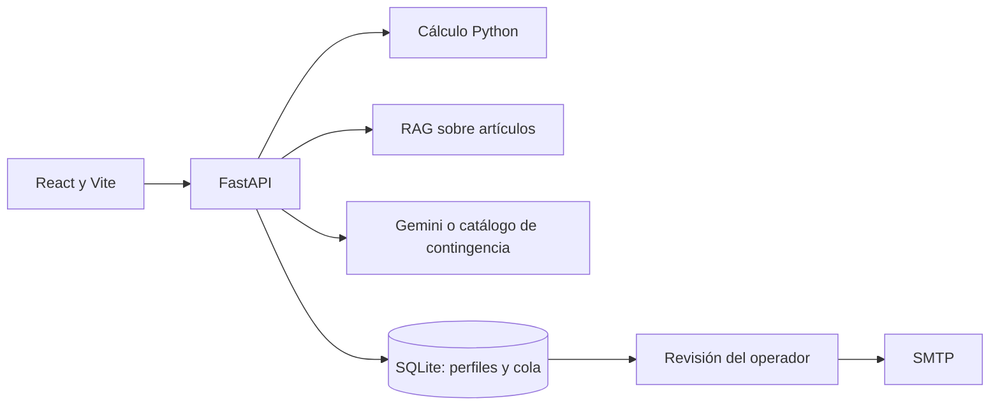

# Calendario Tributario RIMPE

Aplicación académica del Caso 11, Grupo 11, UNIANDES. Genera un calendario para contribuyentes RIMPE de Ecuador, explica obligaciones con Gemini y documentos normativos, y prepara recordatorios sujetos a consentimiento y aprobación humana.

**Estado de la fase 4:** imagen y configuración de despliegue preparadas; [pruebas HTTP locales](docs/08-pruebas-local.md) ejecutadas. **URL pública:** pendiente de publicación y verificación en Render. La demostración Free no guarda perfiles ni envía correos.

## Problema y solución

Los vencimientos dependen del noveno dígito del RUC, el régimen, el período y los días inhábiles. Una fecha incorrecta puede inducir a incumplimiento. El motor Python calcula fechas y montos a partir de [`config/`](config/). Gemini redacta explicaciones; el RAG aporta citas de los documentos procesados. Un operador autenticado revisa cada recordatorio antes de despacharlo.



Las fechas nunca las calcula el modelo. Los datos del formulario pueden utilizarse para generar el calendario sin guardarse. El escaneo periódico solo toma perfiles registrados con consentimiento de correo. El envío comprueba de nuevo ese consentimiento y requiere aprobación de un operador.

## Ejecución local en unos diez minutos

Requisitos: Python 3.11 o 3.12, Node.js 22 y npm. En la raíz del repositorio:

```powershell
Copy-Item .env.example .env
python -m venv .venv
.\.venv\Scripts\Activate.ps1
python -m pip install -r backend/requirements.txt
```

Edite `.env` para añadir `GEMINI_API_KEY` si necesita respuestas generativas en vivo. Sin clave, el servicio usa su catálogo de contingencia. Para registrar perfiles y aprobar correos, configure además `REMINDER_OPERATOR_USER` y una contraseña única de al menos 16 caracteres. El archivo [`.env.example`](.env.example) describe las variables; `.env` está excluido de Git.

Abra dos terminales desde la raíz:

```powershell
# Terminal 1
.\.venv\Scripts\Activate.ps1
python -m uvicorn backend.main:app --reload --port 8000
```

```powershell
# Terminal 2
Set-Location frontend
npm ci
npm run dev
```

Visite [http://localhost:5173](http://localhost:5173). El frontend de desarrollo redirige `/api` y `/health` al backend local. La API ofrece [documentación interactiva](http://localhost:8000/docs) y [salud](http://localhost:8000/health). `SCHEDULER_ENABLED=false` por defecto; active el planificador solo cuando tenga perfiles consentidos y una instancia con almacenamiento duradero.

### Docker local

Con Docker Engine activo y `.env` creado:

```powershell
docker compose up --build
```

Visite [http://localhost:8000](http://localhost:8000). `compose.yaml` conserva SQLite en el volumen `rimpe-data`. La imagen compila React, sirve frontend y API desde el mismo origen, escucha `${PORT}` y ejecuta Uvicorn con un usuario sin privilegios. No incluye `.env`, la cola JSON histórica ni datos personales. Para restaurar un respaldo SQLite, detenga la aplicación y copie una base validada al volumen antes de iniciar de nuevo. Proteja el volumen y cualquier respaldo con permisos de acceso adecuados.

## Despliegue de demostración en Render Free

[`render.yaml`](render.yaml) declara un único Web Service Docker con `/health`. Configura `RIMPE_DEMO_READONLY=true` y `SCHEDULER_ENABLED=false`. El registro de perfiles está bloqueado y no se configuran credenciales de operador ni SMTP. La demostración permite verificar calendario, RAG y explicaciones sin conservar datos personales.

Para desplegar: conecte este repositorio en Render, seleccione Blueprint y revise las variables del servicio. Configure `GEMINI_API_KEY` como secreto en Render solo si desea usar Gemini en vivo; la clave nunca debe entrar en Git. Publique la rama verificada, espere el build y compruebe `/health` y los [casos HTTP](docs/08-pruebas.md). La URL debe añadirse aquí **solo después** de una comprobación real.

[Render Free usa un sistema de archivos efímero](https://render.com/docs/free) y suspende el servicio por inactividad. Por ello esta configuración es una demostración, no el despliegue de recordatorios persistentes. Para el flujo completo se requiere un servicio con [disco persistente](https://render.com/docs/disks) o una base duradera, más secretos de operador y SMTP, HTTPS y un único planificador. Véase [ADR-007](docs/09-decisiones.md).

## Pruebas y evaluación

```powershell
python -m pytest backend/tests/ -q
python eval/run_eval.py --output eval/resultados_semana4_local.json
python scripts/production_checks.py --base-url http://localhost:8000 --output docs/08-pruebas-local.md
```

Tras desplegar, reemplace la URL por la pública y genere `docs/08-pruebas.md`. Para comparar el mismo dataset por HTTP:

```powershell
python eval/run_eval.py --base-url https://SU-SERVICIO.onrender.com --output eval/resultados_evaluacion.json
```

La evaluación usa diez perfiles sintéticos y veinte preguntas normativas. Los resultados de la semana 3 se conservan en [`eval/resultados_semana3.json`](eval/resultados_semana3.json). La comparación documentada está en [`docs/07-evaluacion.md`](docs/07-evaluacion.md). La prueba de una tarifa hipotética modifica solo un YAML temporal; no altera las reglas tributarias oficiales del repositorio.

## Privacidad, autorización y límites

- Las rutas `/api/perfiles` y `/api/flujo` exigen autenticación de operador. El consentimiento de correo empieza desactivado y puede revocarse. La base SQLite y los respaldos contienen datos personales; no se publican.
- Los logs no incluyen RUC ni correo completos. `ENVIADO` significa aceptación por SMTP, no entrega o lectura. `ESTADO_INCIERTO` bloquea el reintento automático.
- El índice RAG y las reglas fiscales reflejan los documentos y la configuración versionados. Deben verificarse contra nuevas publicaciones del SRI antes de usarse para otro ejercicio. No se cambian reglas tributarias por una respuesta del LLM.
- La demostración Free no prueba persistencia tras reinicio, SMTP real ni el planificador diario. Tampoco sustituye la revisión de un profesional contable.
- El servicio público aún no aplica una cuota de solicitudes por cliente. Véase la [matriz de riesgos](docs/riesgos.md).

## Uso ético de IA generativa

Gemini se usa para redactar explicaciones pedagógicas. Python conserva la autoridad sobre cálculos y fechas. El RAG exige citas o se abstiene; las consultas orientadas a evasión reciben rechazo. El agente no autoriza envíos por sí mismo. Los resultados pueden contener errores de interpretación y requieren contraste con las fuentes oficiales.

## Aportes registrados

| Integrante | Aportes verificables en el historial Git |
| --- | --- |
| Cristhian Pinos | Fundamentos y arquitectura; backend tributario y Gemini; pipeline RAG, agente, evaluación y CI (`77adf34`, `adcb736`, `ffb9c3e`, `50b09db`). |
| Juan Lucumi | SPA React y calendario; refactor con `Decimal`, integración SMTP y formulario paso a paso (`c7cec18`, `31cdbed`). |

Los cambios de seguridad, persistencia y fase 4 se documentan en el árbol de trabajo actual; esta tabla refleja commits publicados y no atribuye trabajo no verificado.

## Documentación

- [Arquitectura](docs/03-arquitectura.md)
- [Fuentes normativas](docs/04-fuentes.md)
- [RAG](docs/06-rag.md)
- [Evaluación](docs/07-evaluacion.md)
- [Decisiones técnicas](docs/09-decisiones.md)
- [Automatización y respaldos](docs/10-automatizacion.md)
- [Riesgos](docs/riesgos.md)
