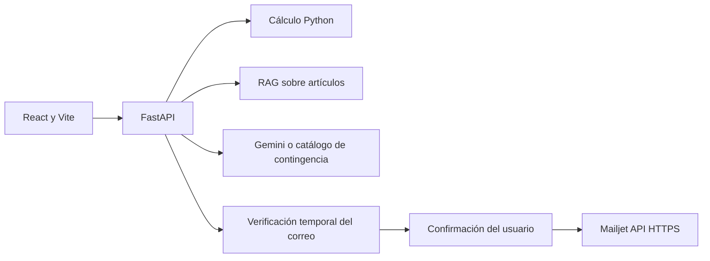

# Calendario Tributario RIMPE

Aplicación académica del Caso 11, Grupo 11, UNIANDES. Genera un calendario para contribuyentes RIMPE de Ecuador, explica obligaciones con Gemini y documentos normativos, y prepara recordatorios sujetos a consentimiento y aprobación humana.

**Demostración pública:** [calendario-rimpe-g11-demo.onrender.com](https://calendario-rimpe-g11-demo.onrender.com/) (Render Free). `/health` identificó el commit [`414bc44`](https://github.com/CristhianPinos/CalendarioTributarioRIMPE/commit/414bc44bfaaffaddcb62dc197db6022bed76a549), aprobado por [CI](https://github.com/CristhianPinos/CalendarioTributarioRIMPE/actions/runs/43366345513). Sobre ese mismo commit pasaron [18/18 pruebas HTTP](docs/08-pruebas.md) y la [evaluación actual](docs/07-evaluacion.md#10-evaluación-de-la-versión-candidata-en-render). La demo no guarda perfiles ni ejecuta el escaneo periódico; el envío puntual usa código y Mailjet.

## Problema y solución

Los vencimientos dependen del noveno dígito del RUC, el régimen, el período y los días inhábiles. Una fecha incorrecta puede inducir a incumplimiento. El motor Python calcula fechas y montos a partir de [`config/`](config/). Gemini redacta explicaciones; el RAG aporta citas de los documentos procesados. El envío puntual requiere confirmar la acción y verificar el correo destinatario con un código temporal.



Las fechas nunca las calcula el modelo. El calendario y los próximos vencimientos aparecen después de completar los tres pasos del perfil y pulsar «Generar Calendario Oficial». El perfil se utiliza durante la sesión para generar el calendario y el recordatorio, sin guardarse. El código de correo vence en diez minutos y se consume una sola vez. El escaneo periódico y la cola histórica quedan fuera de la API pública de esta versión.

La ruta experimental `POST /api/agente/ejecutar` puede pedir a Gemini que elija la siguiente herramienta dentro de una lista cerrada calculada por Python. El backend valida cada elección, limita el número de pasos y registra si decidió Gemini o el flujo seguro. No envía correos desde esa ruta: el despacho puntual conserva la verificación del destinatario y la confirmación humana en `/api/correo`, sin depender de una llamada al modelo después de consumir el código. Si Gemini no responde, el agente completa el recorrido seguro.

El simulador de renta consulta siempre el cálculo determinista de Python con la tabla RIMPE configurada para 2026. Se corrigieron los casos de Emprendedor con ingresos de hasta USD 20.000 y de Negocio Popular que supera ese límite conforme al [art. 97.6 de la LRTI publicada por el SRI](https://www.sri.gob.ec/o/sri-portlet-biblioteca-alfresco-internet/descargar/7da8c609-4299-4597-8825-29446242c63b/LEY_DE_REGIMEN_TRIBUTARIO_INTERNO_-_LRTI.pdf) y la [guía oficial de declaración del ejercicio 2025](https://www.sri.gob.ec/declaracion-impuesto-a-la-renta-2025). La simulación es referencial y no incorpora retenciones ni beneficios individuales.

## Ejecución local en unos diez minutos

Requisitos: Git, Python 3.11 o 3.12, Node.js 22 y npm. En PowerShell:

```powershell
git clone https://github.com/CristhianPinos/CalendarioTributarioRIMPE.git
Set-Location CalendarioTributarioRIMPE
Copy-Item .env.example .env
python -m venv .venv
.\.venv\Scripts\python.exe -m pip install -r backend/requirements.txt
```

Antes de iniciar, abra `.env`: `GEMINI_API_KEY` viene vacía para usar el catálogo de contingencia; añada una clave válida si necesita explicaciones generativas. El modelo predeterminado es [`gemini-3.5-flash-lite`](https://ai.google.dev/gemini-api/docs/models/gemini-3.5-flash-lite), validado localmente con explicaciones estructuradas; puede cambiarlo con `GEMINI_MODEL`. Para enviar correos, configure `MAILJET_API_KEY`, `MAILJET_SECRET_KEY` y `MAILJET_FROM_EMAIL` con un remitente validado en Mailjet. El usuario solicita un código al correo elegido, lo introduce en el modal y confirma el envío; no necesita cuenta de operador ni registrar un perfil. [`.env.example`](.env.example) describe las variables; `.env` está excluido de Git. No use datos personales reales en la demostración Free actual.

Abra dos terminales desde la raíz:

```powershell
# Terminal 1
.\.venv\Scripts\python.exe -m uvicorn backend.main:app --reload --port 8000
```

```powershell
# Terminal 2
Set-Location frontend
npm ci
npm run dev
```

Visite [http://localhost:5173](http://localhost:5173). El frontend de desarrollo redirige `/api` y `/health` al backend local. La API ofrece [documentación interactiva](http://localhost:8000/docs) y [salud](http://localhost:8000/health). El planificador y las rutas de perfiles y cola no se montan en esta versión. El cálculo y la consulta RAG funcionan sin una clave de Gemini.

### Docker local

Con Docker Engine activo y `.env` creado:

```powershell
docker compose up --build
```

Visite [http://localhost:8000](http://localhost:8000). `compose.yaml` define el volumen `rimpe-data` para la implementación SQLite histórica, pero la aplicación actual no monta las rutas de perfiles ni cola y no escribe ahí el perfil del formulario. La imagen compila React, sirve frontend y API desde el mismo origen, escucha `${PORT}` y ejecuta Uvicorn con un usuario sin privilegios. No incluye `.env`, la cola JSON histórica ni datos personales. Si en otra instalación se reactiva la persistencia, proteja el volumen y los respaldos, y restaure una base validada con la aplicación detenida.

## Despliegue de demostración en Render Free

[`render.yaml`](render.yaml) declara un único Web Service Docker con `/health` y `autoDeployTrigger: checksPass`. Configura `RIMPE_DEMO_READONLY=true` y `SCHEDULER_ENABLED=false`; las credenciales de Mailjet se configuran únicamente en el panel. La demo respondió con `gemini-3.5-flash-lite`, tokens de generación y la fecha determinada por Python. El usuario solicitó un código desde el modal, autorizó el envío y confirmó la recepción del recordatorio en Gmail. CI comprueba secretos, pruebas, evaluación, frontend e imagen antes del despliegue automático.

La instancia actual se creó mediante Blueprint y está disponible en la [URL verificada](https://calendario-rimpe-g11-demo.onrender.com/). Para reproducir el despliegue, conecte este repositorio en Render, seleccione Blueprint, revise las variables del servicio y guarde `GEMINI_API_KEY` como secreto si necesita Gemini en vivo. Publique una rama verificada, espere el build y compruebe `/health` y los [casos HTTP](docs/08-pruebas.md). La clave nunca debe entrar en Git.

[Render Free usa un sistema de archivos efímero](https://render.com/docs/free) y suspende el servicio por inactividad. Por ello esta configuración sigue siendo una demostración; el código temporal se perderá si el servicio reinicia. Mailjet utiliza HTTPS y requiere claves configuradas en el servidor. Para reactivar recordatorios periódicos haría falta almacenamiento duradero y un rediseño de consentimiento y autorización. Véase [ADR-007](docs/09-decisiones.md).

## Pruebas y evaluación

```powershell
.\.venv\Scripts\python.exe -m pytest backend/tests/ -q
.\.venv\Scripts\python.exe eval/run_eval.py --output eval/resultados_reproduccion_local.json
.\.venv\Scripts\python.exe scripts/production_checks.py --base-url http://localhost:8000 --output docs/08-pruebas-reproduccion-local.md
```

La batería de 18 casos y la evaluación ya se ejecutaron contra el commit `414bc44` en la URL pública. Para repetirlas sin reemplazar los informes archivados:

```powershell
.\.venv\Scripts\python.exe scripts/production_checks.py --base-url https://calendario-rimpe-g11-demo.onrender.com --output docs/08-pruebas-reproduccion.md
.\.venv\Scripts\python.exe eval/run_eval.py --base-url https://calendario-rimpe-g11-demo.onrender.com --output eval/resultados_reproduccion_render.json
```

La evaluación usa diez perfiles sintéticos y veinte preguntas normativas. Para probar manualmente el formulario hay [15 casos ficticios sin correo](docs/datos-prueba-perfiles.md); no se cargan en la aplicación ni prueban inscripción real en el SRI. Los resultados de la semana 3 se conservan en [`eval/resultados_semana3.json`](eval/resultados_semana3.json). La [auditoría RAG anterior](docs/07-evaluacion.md#9-auditoría-local-del-rag-posterior-a-la-revisión-de-fuentes) registró 15/16 aciertos por artículo y 4/5 por documento y artículo en la muestra curada. La [corrección local de PREG-02](docs/07-evaluacion.md#11-corrección-local-de-la-consulta-preg-02) recupera la fuente directa y alcanza 16/16 y 5/5, respectivamente; falta comprobar esta versión en Render. La prueba de una tarifa hipotética modifica solo un YAML temporal; no altera las reglas tributarias oficiales del repositorio.

## Privacidad, autorización y límites

- Las rutas `/api/perfiles` y `/api/flujo` no están expuestas. El envío puntual requiere código temporal enviado al destinatario, confirmación explícita y un intervalo mínimo entre envíos al mismo correo. No se guarda el perfil tributario; los códigos y contadores de tasa viven solo en memoria del proceso.
- `POST /api/obligaciones/explicar` limita las consultas por IP (12 por 60 segundos) y por instancia (30 por 60 segundos); al agotar la ventana responde `429` con `Retry-After`. Los valores se pueden ajustar con `GEMINI_RATE_LIMIT_PER_CLIENT`, `GEMINI_RATE_LIMIT_GLOBAL` y `GEMINI_RATE_LIMIT_WINDOW_SECONDS`. La entrada variable y la salida de Gemini están acotadas. Los contadores se reinician con el proceso y no se comparten entre instancias; para varias réplicas se requeriría un almacén compartido.
- `/api/agente/ejecutar` comparte esa cuota y reserva cuatro llamadas por ejecución, máximo de una selección por herramienta. El selector no transmite RUC, correo, nombre, importe ni la instrucción libre a Gemini. En Render, las tres herramientas de una ejecución sintética se seleccionaron con origen `gemini` y el envío quedó `PENDIENTE_CONFIRMACION`.
- Los logs no incluyen RUC ni correo completos. `ENVIADO` significa aceptación por Mailjet, no entrega o lectura. `ESTADO_INCIERTO` bloquea el reintento automático en la cola histórica.
- El índice RAG y las reglas fiscales reflejan los documentos y la configuración versionados. Deben verificarse contra nuevas publicaciones del SRI antes de usarse para otro ejercicio. No se cambian reglas tributarias por una respuesta del LLM.
- El commit anterior `2444cb3` usaba `gemini-3.8-flash` y devolvió contingencia ante 429 y 503 del proveedor. Flash Lite respondió en la prueba pública posterior; eso no garantiza cuota ni disponibilidad continuas. La aplicación no sustituye la revisión de un profesional contable. Véase la [matriz de riesgos](docs/riesgos.md).

## Uso ético de IA generativa

La [declaración de uso de IA](docs/declaracion-uso-ia.md) identifica las funciones de Gemini, el papel del RAG y de Python, la asistencia de IA durante el desarrollo y los límites verificados. La [bitácora de semana 4](docs/evidencias/semana-4/bitacora-semana-4.md#2-observaciones-de-la-revisión-y-respuesta-del-proyecto) responde a las observaciones de la revisión y distingue los resultados históricos de los actuales; las [decisiones de la semana](docs/evidencias/semana-4/decisiones-semana-4.md) explican las soluciones elegidas.

Gemini se usa para redactar explicaciones pedagógicas. Python conserva la autoridad sobre cálculos y fechas. El RAG exige citas o se abstiene; las consultas orientadas a evasión reciben rechazo. El agente no autoriza envíos por sí mismo. Los resultados pueden contener errores de interpretación y requieren contraste con las fuentes oficiales.

## Aportes registrados

| Integrante | Aportes verificables en el historial Git |
| --- | --- |
| Cristhian Pinos | Fundamentos y arquitectura; backend tributario y Gemini; pipeline RAG, agente, evaluación y CI (`77adf34`, `adcb736`, `ffb9c3e`, `50b09db`). |
| Juan Lucumi | SPA React y calendario; refactor con `Decimal`, integración SMTP y formulario paso a paso (`c7cec18`, `31cdbed`). |

La tabla atribuye únicamente aportes respaldados por commits. Los controles de seguridad y persistencia y el empaquetado inicial de la fase 4 figuran en el commit [`84cc378`](https://github.com/CristhianPinos/CalendarioTributarioRIMPE/commit/84cc378bac8fc1322818c24451b54f78bde86e02) de Cristhian Pinos. Las comprobaciones posteriores de CI y Render se documentan con sus propios commits y resultados.

## Documentación

- [Arquitectura](docs/03-arquitectura.md)
- [Fuentes normativas](docs/04-fuentes.md)
- [RAG](docs/06-rag.md)
- [Evaluación](docs/07-evaluacion.md)
- [Decisiones técnicas](docs/09-decisiones.md)
- [Automatización y respaldos](docs/10-automatizacion.md)
- [Riesgos](docs/riesgos.md)
- [Presentación de sustentación en PDF](docs/sustentacion-grupo11.pdf)
