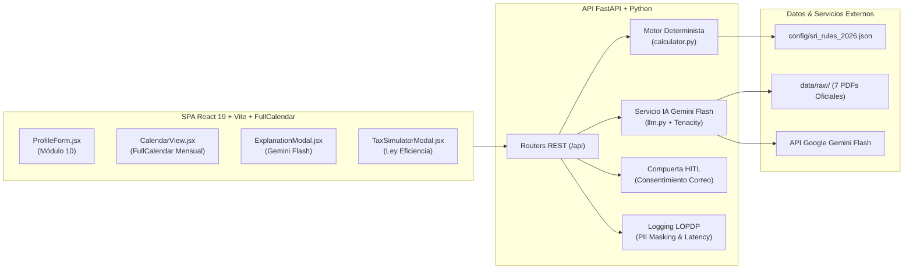

# Calendario Tributario Personalizado con Recordatorios para Emprendedores RIMPE

> **Plataforma Inteligente de Cumplimiento Fiscal con Agente RAG Normativo y Automatización Programada de Notificaciones (Human-in-the-Loop)**

[](https://fastapi.tiangolo.com/)
[](https://www.python.org/)
[](https://react.dev/)
[](https://tailwindcss.com/)
[](https://fullcalendar.io/)
[](https://www.sri.gob.ec)
[](backend/tests/)

---

## 📋 Metadatos del Proyecto
* **Carrera:** Ingeniería de Software
* **Asignatura:** Ingeniería de Software con IA Generativa: Desarrollo de Aplicaciones Inteligentes
* **Caso de Estudio:** Caso N.º 11 – Grupo 11
* **Tipo de Producto:** Automatización de procesos con agente de alcance controlado y RAG
* **Fase Actual:** Fase 2 – Construcción del MVP e integración con IA generativa (Semana 2)

---

## 📌 1. Descripción del Problema y Solución

En Ecuador, cientos de miles de emprendedores y personas de negocios populares inscritos en el **Régimen Simplificado para Emprendedores y Negocios Populares (RIMPE)** desconocen sus fechas límite de declaración, los comprobantes válidos que deben emitir y las tarifas vigentes. Aunque el Servicio de Rentas Internas (**SRI**) publica resoluciones y guías, su lenguaje técnico y las reglas cambiantes del noveno dígito del RUC generan atrasos sancionados con multas e intereses.

### La Solución:
Una aplicación web híbrida con **interfaz principal centrada en Calendario** (no un chatbot abierto) que:
1. **Perfilamiento y Validación:** Registra el perfil del contribuyente validando su RUC en tiempo real mediante el algoritmo Módulo 10 de personas naturales.
2. **Cálculo Determinista Inmutable:** Computa las fechas exactas de declaración de IVA y Renta por noveno dígito y feriados de Ecuador sin intervención probabilística del LLM (cero alucinaciones).
3. **Agente Pedagógico RAG:** Al interactuar con el calendario, Google Gemini Flash consulta los 7 PDFs oficiales del SRI indexados y redacta explicaciones didácticas en lenguaje ciudadano bajo esquemas Pydantic estrictos (`RecordatorioEstructurado`).
4. **Flujo Programado con Compuerta Humana (*Human-in-the-Loop*):** Un planificador de recordatorios detecta vencimientos a $T - 5$ días. Ningún correo sale sin la confirmación explícita del usuario (`confirmado_por_usuario == True`).
5. **Simulador de Impuesto a la Renta:** Simula de forma determinista la cuota fija o la tarifa progresiva de Renta según el Art. 23 de la Ley de Eficiencia Económica (R.O. Suplemento 461).

---

## 🏛️ 2. Arquitectura del Sistema (Resumen C4)



Para consultar los diagramas C4 de Contexto, Contenedores y el diagrama de secuencia completo, revise el documento [`docs/03-arquitectura.md`](docs/03-arquitectura.md).

---

## 📂 3. Estructura del Repositorio

El proyecto sigue una arquitectura desacoplada, modular y 100% testeada:

```text
CalendarioTributarioRIMPE/
├── .env.example                     # Plantilla pública de variables de entorno
├── .gitignore                       # Exclusión de claves (.env), cachés y artefactos
├── README.md                        # Guía de instalación, arquitectura y ejecución
├── HANDOFF.md                       # Documento formal de traspaso de fase y contratos
├── config/
│   └── sri_rules_2026.json          # Reglas tributarias 2026 desacopladas (0% hardcoding)
├── data/
│   └── raw/                         # 7 Cuerpos normativos íntegros oficiales en PDF
├── docs/                            # Documentación técnica, ADRs y evidencias
│   ├── 01-propuesta.md              # Propuesta, alcance y matriz de riesgos
│   ├── 02-requisitos.md             # 10 Historias de usuario Gherkin y 7 RNF medibles
│   ├── 03-arquitectura.md           # Diagramas C4 y arquitectura del sistema
│   ├── 04-fuentes.md                # Catálogo de los 7 PDFs oficiales del SRI
│   ├── 05-prompts.md                # Benchmark de prompts (v1, v2, v3) y matriz de evaluación
│   ├── 09-decisiones.md             # Registro formal de 6 ADRs arquitectónicos
│   ├── levantamiento-preguntas.md   # 16 casos reales de contribuyentes ecuatorianos
│   └── evidencias/
│       ├── semana-1/                # Bitácora y decisiones de Fase 1
│       │   ├── bitacora-semana-1.md
│       │   └── decisiones-semana-1.md
│       └── semana-2/                # Bitácora y decisiones de Fase 2
│           ├── bitacora-semana-2.md
│           └── decisiones-semana-2.md
├── backend/                         # Servidor API REST en FastAPI
│   ├── main.py                      # Punto de entrada FastAPI, CORS y middleware LOPDP
│   ├── requirements.txt             # Dependencias del backend (FastAPI, Gemini, Tenacity, Pytest)
│   ├── schemas.py                   # Modelos y contratos de datos Pydantic v2
│   ├── middleware/
│   │   └── logging_lopdp.py         # Middleware de auditoría y enmascaramiento de PII
│   ├── prompts/                     # Plantillas versionadas de prompts del sistema
│   │   ├── system_v1.md             # Prompt v1 (Naïve)
│   │   ├── system_v2.md             # Prompt v2 (Intermedio)
│   │   └── system_v3.md             # Prompt v3 (Producción - Zero Date Hallucination)
│   ├── routers/
│   │   ├── calendario_router.py     # Endpoints de cálculo de calendario, feriados y RUC
│   │   └── obligaciones_router.py   # Endpoints de explicación con IA y simulador de renta
│   ├── services/
│   │   ├── calculator.py            # Motor determinista (Módulo 10, 9no dígito, feriados)
│   │   └── llm.py                   # Servicio Gemini Flash con reintentos Tenacity y Fail-Safe
│   └── tests/                       # Suite de pruebas automatizadas (120 tests - 100% Green)
│       ├── test_calculator.py       # 64 tests unitarios del motor determinista
│       ├── test_schemas.py          # 11 tests unitarios de esquemas Pydantic v2
│       ├── test_llm_service.py      # 10 tests unitarios del servicio de IA y contingencia
│       ├── test_routers_and_middleware.py # 13 tests de endpoints y middleware LOPDP
│       ├── test_api_mock.py         # 8 tests de integración con mocks offline
│       ├── test_calendario_router.py # 9 tests del router de calendario y feriados
│       └── test_e2e_integration.py  # 5 tests de integración End-to-End
└── frontend/                        # Aplicación Single Page Application (SPA)
    ├── package.json                 # Dependencias (React 19, Vite, Tailwind CSS, FullCalendar)
    ├── vite.config.js               # Configuración de Vite y Tailwind v4
    ├── index.html                   # Entrada web institucional en español
    └── src/
        ├── main.jsx                 # Montaje de la aplicación React
        ├── App.jsx                  # Orquestador principal y layout responsive
        ├── index.css                # Estilos globales y personalización de FullCalendar
        ├── utils/
        │   └── rucValidator.js      # Validador client-side de RUC Módulo 10 (Ecuador)
        ├── services/
        │   └── apiClient.js         # Cliente HTTP hacia FastAPI con control de errores
        └── components/
            ├── Navbar.jsx           # Cabecera con monitor de estado de API en vivo
            ├── ProfileForm.jsx      # Formulario de perfil con feedback visual de RUC
            ├── CalendarView.jsx     # Cuadrícula interactiva FullCalendar y lista de eventos
            ├── ExplanationModal.jsx # Modal didáctico con IA Gemini y compuerta HITL
            ├── TaxSimulatorModal.jsx # Modal simulador de Impuesto a la Renta progresivo
            └── Footer.jsx           # Pie de página institucional y cumplimiento LOPDP
```

---

## 🚀 4. Guía de Ejecución Local (Paso a Paso)

### Requisitos del Sistema:
* **Python 3.10 o superior** (probado y certificado en Python 3.14).
* **Node.js 18+ y npm** (probado con Node v24 y npm 11).
* **Clave de API de Google Gemini** (Google AI Studio).

---

### Terminal 1: Iniciar el Servidor Backend (FastAPI)

```bash
# 1. Instalar las dependencias de Python
pip install -r backend/requirements.txt

# 2. Configurar la clave de API en el archivo .env
# (Asegúrate de tener tu archivo .env en la raíz con tu GEMINI_API_KEY)
# Ejemplo:
# GEMINI_API_KEY=tu_clave_de_google_ai_studio
# GEMINI_MODEL=gemini-3-flash-preview

# 3. Ejecutar las 120 pruebas automatizadas para certificar el estado
python -m pytest backend/tests/ -v

# 4. Iniciar el servidor backend en desarrollo
uvicorn backend.main:app --reload --port 8000
```

El backend quedará operativo en:
* **Documentación Interactiva (Swagger UI):** [http://localhost:8000/docs](http://localhost:8000/docs)
* **Verificación de Salud (Health Check):** [http://localhost:8000/health](http://localhost:8000/health)

---

### Terminal 2: Iniciar la Aplicación Frontend (React + Vite)

```bash
# 1. Entrar a la carpeta frontend
cd frontend

# 2. Instalar dependencias de Node.js (si no se han instalado previamente)
npm install

# 3. Iniciar el servidor de desarrollo de Vite
npm run dev
```

La aplicación web abrirá en tu navegador en:
👉 **[http://localhost:5173](http://localhost:5173)**

---

## 🧪 5. Suite de Pruebas Automatizadas (QA)

El proyecto cuenta con **120 pruebas automatizadas** con cobertura exhaustiva, ejecutables en ~10 segundos con `pytest`:

```bash
python -m pytest backend/tests/ -v
```

| Módulo de Prueba | Cantidad | Alcance Técnico |
| :--- | :---: | :--- |
| `test_calculator.py` | 64 | Algoritmo Módulo 10 de RUC, 10 novenos dígitos, prórrogas por fines de semana y feriados del SRI. |
| `test_schemas.py` | 11 | Validación de tipos Pydantic v2, límites de longitud y esquema `RecordatorioEstructurado`. |
| `test_llm_service.py` | 10 | Servicio Gemini Flash, 5 plantillas del catálogo de contingencia y reintentos Tenacity. |
| `test_routers_and_middleware.py` | 13 | Endpoints de FastAPI, middleware LOPDP de enmascaramiento de PII y cabeceras `X-Process-Time-Ms`. |
| `test_api_mock.py` | 8 | Pruebas de integración de la API con mocks offline (Happy Path, 422, 429 y 503). |
| `test_calendario_router.py` | 9 | Endpoints de cálculo de calendario, feriados oficiales y validación rápida de RUC. |
| `test_e2e_integration.py` | 5 | Pruebas End-to-End completas de los 4 flujos de usuario e integridad del build de frontend. |
| **TOTAL** | **120** | **100% Passed (Green)** |

---

## ⚖️ Licencia y Responsabilidad Legal
Este proyecto fue desarrollado con fines estrictamente formativos dentro de la asignatura de **Ingeniería de Software con IA Generativa**. La plataforma **no sustituye la asesoría legal o contable de un Contador Público Autorizado (CPA)** ni realiza declaraciones tributarias autónomas ante el SRI.
