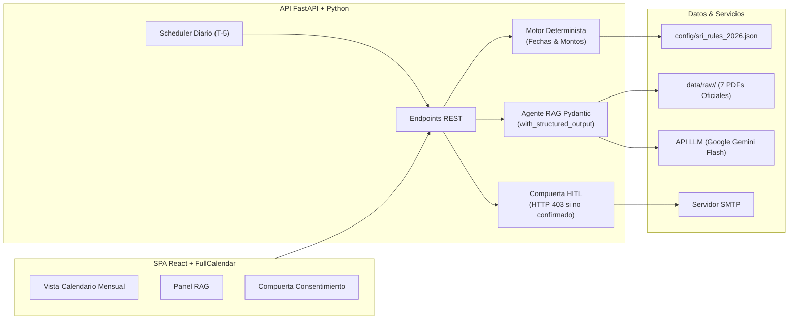

# Calendario Tributario Personalizado con Recordatorios para Emprendedores RIMPE

> **Plataforma Inteligente de Cumplimiento Fiscal con Agente RAG Normativo y Automatización Programada de Notificaciones (Human-in-the-Loop)**

[](https://fastapi.tiangolo.com/)
[](https://www.python.org/)
[](https://react.dev/)
[](https://tailwindcss.com/)
[](https://fullcalendar.io/)
[](https://www.sri.gob.ec)

---

## 📋 Metadatos del Proyecto
* **Carrera:** Ingeniería de Software
* **Asignatura:** Ingeniería de Software con IA Generativa: Desarrollo de Aplicaciones Inteligentes
* **Caso de Estudio:** Caso N.º 11 – Grupo 11
* **Tipo de Producto:** Automatización de procesos con agente de alcance controlado y RAG
* **Período:** Octubre 2024 / Fase 1 (Semana 1)

---

## 📌 1. Descripción del Problema y Solución

En Ecuador, cientos de miles de emprendedores y personas de negocios populares inscritos en el **Régimen Simplificado para Emprendedores y Negocios Populares (RIMPE)** desconocen sus fechas límite de declaración, los comprobantes válidos que deben emitir y las tarifas vigentes. Aunque el Servicio de Rentas Internas (**SRI**) publica resoluciones y guías, su lenguaje técnico y las reglas cambiantes del noveno dígito del RUC generan atrasos sancionados con multas e intereses.

### La Solución:
Una aplicación web híbrida con **interfaz principal centrada en Calendario** (no un chatbot abierto) que:
1. **Perfilamiento y Validación:** Registra el perfil del contribuyente validando su RUC mediante el algoritmo Módulo 10.
2. **Cálculo Determinista Inmutable:** Computa las fechas exactas de declaración de IVA y Renta por noveno dígito y feriados de Ecuador (`calendar.monthrange`) sin intervención probabilística del LLM (cero alucinaciones).
3. **Agente Pedagógico RAG:** Al interactuar con el calendario, un modelo generativo consulta los 7 PDFs oficiales del SRI indexados y redacta explicaciones didácticas en lenguaje ciudadano bajo esquemas Pydantic estrictos.
4. **Flujo Programado con Compuerta Humana (*Human-in-the-Loop*):** Un planificador en segundo plano detecta vencimientos a $T - 5$ días y genera borradores. Ningún correo sale sin la confirmación explícita del usuario (`confirmado_por_usuario == True`).

---

## 🏛️ 2. Arquitectura del Sistema (Resumen C4)



Para consultar los diagramas C4 de Contexto, Contenedores y el diagrama de secuencia completo, revise el documento [`docs/03-arquitectura.md`](docs/03-arquitectura.md).

---

## 📂 3. Estructura del Repositorio

El proyecto sigue la estructura estándar y modular requerida para plataformas con IA Generativa:

```text
CalendarioTributarioRIMPE/
├── .env.example                     # Plantilla de variables de entorno desacopladas
├── .gitignore                       # Filtro de exclusión para Git (Python, Node, Secrets)
├── README.md                        # Documentación principal del proyecto
├── config/                          # Parámetros tributarios desacoplados (0% hardcoding)
│   └── sri_rules_2026.json          # Reglas del 9no dígito, tarifas y feriados
├── data/
│   └── raw/                         # Documentos oficiales íntegros del SRI (PDFs)
│       ├── 01_resolucion_sri_nac_dgercgc24_00000027.pdf
│       ├── 02_resolucion_sri_nac_dgercgc23_00000034_calendario.pdf
│       ├── 03_ley_organica_eficiencia_economica_registro_oficial_461.pdf
│       ├── 04_reglamento_aplicacion_lrti.pdf
│       ├── 05_ley_regimen_tributario_interno_lrti.pdf
│       ├── 06_codigo_tributario_ecuador.pdf
│       └── 07_reglamento_comprobantes_venta_retencion.pdf
├── docs/                            # Documentación de ingeniería y diseño
│   ├── 01-propuesta.md              # Problema real, alcance, riesgos y modelo
│   ├── 02-requisitos.md             # 10 Historias de usuario, RNF y modelo de datos
│   ├── 03-arquitectura.md           # Diagramas C4, secuencia y matriz de responsabilidades
│   ├── 04-fuentes.md                # Catálogo de fuentes y estrategia de fragmentación
│   ├── levantamiento-preguntas.md   # 16 casos de estudio reales de contribuyentes
│   └── evidencias/                  # Bitácoras de avance y capturas
│       └── semana-1/
│           └── decisiones-semana-1.md
├── backend/                         # Servidor API REST y motor de IA (FastAPI)
│   ├── main.py                      # Punto de entrada de la aplicación FastAPI
│   └── requirements.txt             # Dependencias del backend
└── frontend/                        # Aplicación de usuario (SPA React + Tailwind)
```

---

## 📚 4. Índice de Documentación Oficial de la Fase 1

Todos los entregables de la **Semana 1** se encuentran formalmente redactados en la carpeta `docs/`:

1. 📄 [**01-propuesta.md**](docs/01-propuesta.md): Justificación técnica, arquetipos de usuario, alcance positivo, alcance negativo estricto y matriz de riesgos.
2. 📄 [**02-requisitos.md**](docs/02-requisitos.md): 10 Historias de Usuario en formato Gherkin (`Dado... Cuando... Entonces...`), 7 Requisitos No Funcionales medibles y esquemas relacionales/Pydantic.
3. 📄 [**03-arquitectura.md**](docs/03-arquitectura.md): Diagramas C4 (Contexto y Contenedores), diagrama de secuencia autonumerado y matriz de separación de responsabilidades con Tenacity y compuerta HITL.
4. 📄 [**04-fuentes.md**](docs/04-fuentes.md): Inventario de 7 cuerpos normativos oficiales en PDF, parámetros de fragmentación RAG (*chunk size* 400-700 tokens) y esquema de metadatos para filtrado híbrido.
5. 📄 [**levantamiento-preguntas.md**](docs/levantamiento-preguntas.md): 16 preguntas reales y frecuentes de contribuyentes RIMPE clasificadas por técnica de resolución (Determinista / RAG).
6. 📄 [**decisiones-semana-1.md**](docs/evidencias/semana-1/decisiones-semana-1.md): Registro histórico de acuerdos y decisiones técnicas tomadas en la Semana 1.

---

## 🚀 5. Puesta en Marcha (Entorno de Desarrollo)

### Requisitos Previos:
* Python 3.10 o superior instalado.
* Node.js 18+ y npm / yarn (para el frontend).
* Clave de API de Google Gemini (Google AI Studio).

### Configuración del Backend:
```bash
# 1. Crear entorno virtual
python -m venv .venv

# 2. Activar entorno virtual (Windows PowerShell)
.venv\Scripts\Activate.ps1

# 3. Instalar dependencias
pip install -r backend/requirements.txt

# 4. Configurar variables de entorno
cp .env.example .env
# Editar .env con tus claves de API

# 5. Ejecutar servidor de desarrollo
uvicorn backend.main:app --reload --port 8000
```
El servidor responderá con documentación interactiva en:
* Swagger UI: [http://localhost:8000/docs](http://localhost:8000/docs)
* Health Check: [http://localhost:8000/health](http://localhost:8000/health)

---

## ⚖️ Licencia y Responsabilidad Legal
Este proyecto fue desarrollado con fines estrictamente formativos dentro de la asignatura de **Ingeniería de Software con IA Generativa**. La plataforma **no sustituye la asesoría legal o contable de un Contador Público Autorizado (CPA)** ni realiza declaraciones tributarias autónomas ante el SRI.
