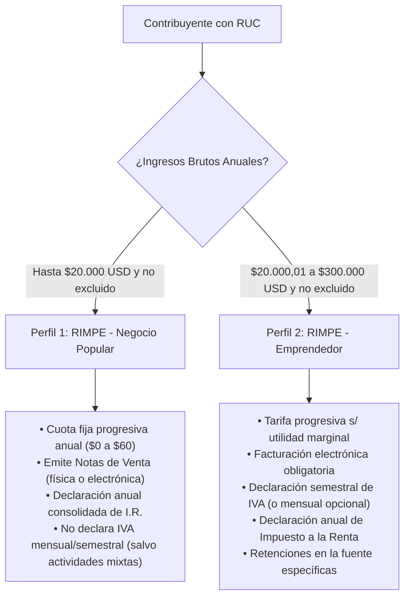
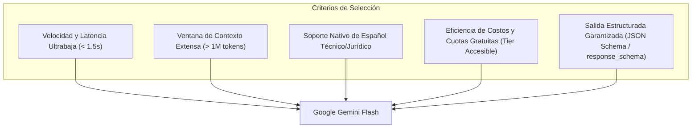

# Propuesta de Proyecto: Calendario Tributario Inteligente para Emprendedores RIMPE

| Metadato | Detalle |
| :--- | :--- |
| **Carrera** | Software |
| **Asignatura** | Ingeniería de Software con IA Generativa: Desarrollo de Aplicaciones Inteligentes |
| **Caso / Grupo** | Caso N.º 11 – Grupo 11 |
| **Tema** | Calendario Tributario Personalizado con Recordatorios para Emprendedores RIMPE (Agente de obligaciones tributarias con RAG sobre normativa del SRI – Flujo programado de notificaciones) |
| **Tipo de Producto** | Automatización de proceso con agente y RAG |
| **Fecha de Elaboración** | Octubre 2024 |
| **Versión** | 1.0.0 |

---

## 1. Definición del Problema Real

En el Ecuador, el Régimen Simplificado para Emprendedores y Negocios Populares (**RIMPE**), introducido por la *Ley Orgánica para el Desarrollo Económico y Sostenibilidad Fiscal tras la Pandemia COVID-19* y modificado sustancialmente por la *Ley Orgánica de Eficiencia Económica y Generación de Empleo* (diciembre de 2023) y resoluciones periódicas del Servicio de Rentas Internas (**SRI**), congrega a más de un millón de microempresarios y personas naturales.

A pesar de su objetivo de simplificación administrativa, el ecosistema tributario presenta barreras críticas para el contribuyente:

1. **Ambigüedad en la categorización y deberes formales:** Los contribuyentes suelen desconocer si califican como **Negocio Popular** (ingresos brutos anuales de hasta \$20.000,00 USD) o **Emprendedor** (ingresos de \$20.000,01 hasta \$300.000,00 USD), o si realizan actividades excluyentes (ej. servicios profesionales, rentas de capital, comisionistas) que deben tributar bajo Régimen General simultáneamente.
2. **Confusión en tipos de comprobantes y tarifas:** Existen dudas recurrentes sobre cuándo emitir notas de venta físicas o electrónicas con tarifa 0% de IVA (Negocios Populares) frente a facturación electrónica obligatoria desglosando IVA (Emprendedores).
3. **Complejidad del calendario de vencimientos:** Las fechas límites de declaración y pago no son estáticas; dependen del **noveno dígito del Registro Único de Contribuyentes (RUC)** y se ajustan dinámicamente cuando caen en fines de semana o feriados nacionales/locales según el Código Tributario ecuatoriano.
4. **Barrera de lenguaje técnico y asimetría informativa:** Las resoluciones (ej. NAC-DGERCGC), circulares y guías oficiales del SRI utilizan jerga legal-financiera densa. Esto provoca que pequeños comerciantes omitan declaraciones o cometan errores en casilleros de formularios (como el Formulario Múltiple 106 o Formularios de IVA/Renta).
5. **Impacto socioeconómico de sanciones:** El incumplimiento involuntario acarrea multas por contravenciones y declaraciones tardías (mínimo \$30,00 USD por obligación no presentada según resolución de multas del SRI) e intereses por mora, afectando gravemente la liquidez de negocios con márgenes operativos reducidos.

---

## 2. Arquetipos de Usuario y Perfiles Destinatarios

La plataforma se orienta a dos perfiles específicos de personas naturales y pequeños negocios con RUC activo en Ecuador:

### Perfil 1: Negocio Popular RIMPE (Persona Natural)
* **Perfil:** Propietarios de tiendas de barrio, bazares, peluquerías, panaderías o artesanos.
* **Nivel tecnológico:** Medio a bajo; operan principalmente desde dispositivos móviles.
* **Puntos de dolor:** Desconocimiento de fechas de pago de la cuota fija patrimonial/anual, extravío de comprobantes, pánico al recibir notificaciones o correos automáticos del SRI.
* **Necesidad:** Saber exactamente qué día pagar, cuánto pagar según su tabla, cómo llenar el comprobante básico y recibir explicaciones redactadas como si hablara con un asesor de confianza.

### Perfil 2: Emprendedor RIMPE (Persona Natural o Microempresa)
* **Perfil:** Pequeños comercializadores, talleres de manufactura, cafeterías, comercios electrónicos locales.
* **Nivel tecnológico:** Medio; manejan herramientas ofimáticas básicas y software de facturación electrónica.
* **Puntos de dolor:** Coordinar fechas de IVA semestral (julio y enero) con el cierre anual de Renta (marzo/abril), manejar retenciones y conciliar notas de crédito.
* **Necesidad:** Visualizar en un calendario integral sus fechas límites por noveno dígito, entender qué casilleros básicos declarar y recibir recordatorios anticipados por correo con el respaldo normativo oficial.

---

## 3. Alcance de la Solución

### 3.1. Alcance Positivo (Lo que SÍ hará la plataforma)
* **Registro y perfilamiento inteligente:** Captura estructurada de datos básicos: número de RUC (validando algoritmo módulo 10 para personas naturales), tipo de régimen RIMPE autodeclarado o seleccionado, actividad económica principal y correo de contacto.
* **Cálculo determinista de obligaciones:** Motor de reglas basado en código estricto que calcula con precisión matemática las fechas de vencimiento según el noveno dígito del RUC y el calendario oficial del SRI, considerando prórrogas por fines de semana y feriados.
* **Interfaz principal centrada en Calendario:** Visualización interactiva y visual (mensual y anual) donde las obligaciones tributarias aparecen como eventos claros y categorizados, no como un chatbot abierto desestructurado.
* **Generación explicativa contextual con RAG (Retrieval-Augmented Generation):**
  - Al seleccionar una obligación o generar un recordatorio, un agente consulta una base de conocimiento vectorial indexada con normativa oficial vigente del SRI (Ley de Régimen Tributario Interno, Reglamento, Ley de Eficiencia Económica, Guías de Negocios Populares y Emprendedores).
  - El modelo traduce el lenguaje legal a explicaciones didácticas en lenguaje sencillo ("ciudadano"), señalando base legal, formulario sugerido y recomendaciones operativas.
* **Flujo programado de notificaciones (Scheduler con HITL - Human-In-The-Loop):**
  - Un servicio en segundo plano detecta obligaciones próximas a vencer (ej. 7 días y 2 días antes).
  - El sistema redacta un borrador de recordatorio con apoyo del LLM/RAG.
  - Se requiere la **confirmación / aprobación explícita del usuario** en la interfaz para autorizar el despacho final del correo electrónico a su bandeja personal.

### 3.2. Alcance Negativo Estricto (Lo que NUNCA hará)
Para garantizar la responsabilidad legal, seguridad y viabilidad técnica, el sistema delimita taxativamente lo siguiente:
1. **NO realizará declaraciones de impuestos por el usuario:** La plataforma no se conecta a las credenciales del portal `SRI en Línea` ni envía formularios tributarios de forma autónoma.
2. **NO sustituye el criterio ni la asesoría de un Contador Público Autorizado (CPA):** Toda recomendación generada por IA incluye un descargo de responsabilidad legal (*disclaimer*) formativo.
3. **NO llevará contabilidad de partida doble, balances ni libros diarios:** No es un software contable ERP.
4. **NO será un chatbot conversacional de propósito general:** La interacción no se fundamenta en una caja de diálogo abierta de soporte, sino en la interacción directa con el calendario de eventos y tarjetas explicativas asociadas.
5. **NO manejará transferencias de dinero ni recaudación directa:** No procesa pagos bancarios ni débitos automáticos con el SRI.

---

## 4. Matriz de Riesgos y Estrategias de Mitigación

| Riesgo Identificado | Severidad / Probabilidad | Impacto Técnico / Operativo | Estrategia de Mitigación |
| :--- | :--- | :--- | :--- |
| **Alucinación en fechas o fórmulas tributarias** | Crítica / Media | Un contribuyente podría recibir una fecha errónea y ser multado por el SRI. | **Arquitectura híbrida estricta:** Las fechas, plazos y cálculos aritméticos se calculan 100% de forma determinista mediante funciones en backend (Python). El LLM/RAG tiene prohibido calcular fechas matemáticas; solo recibe la fecha calculada y redacta el texto pedagógico. |
| **Desactualización normativa (Derogatorias SRI)** | Alta / Alta | La Asamblea Nacional o el SRI cambian tarifas o reglamentos (muy frecuente en Ecuador). | Ingesta modular de fuentes en la base vectorial con metadatos de vigencia temporal y versionado explícito en `docs/04-fuentes.md`. |
| **Envío masivo no deseado o spam de correos** | Media / Baja | Penalización de reputación SMTP y molestia al usuario. | Implementación obligatoria de **Human-In-The-Loop (HITL)**: ningún correo sale sin previsualización y confirmación manual del usuario desde el calendario. |
| **Ingesta de RUC no válido o datos inconsistentes** | Media / Media | Fechas de vencimiento asignadas a dígitos incorrectos. | Validación del dígito verificador del RUC (algoritmo ecuatoriano Módulo 10 para personas naturales) previa al registro en frontend y backend. |
| **Latencia o costo excesivo de la API generativa** | Media / Baja | Lentitud en la carga de tarjetas o presupuestos agotados. | Uso de modelos optimizados en latencia y costo (familia Flash), combinados con caché de explicaciones estándar para obligaciones recurrentes. |

---

## 5. Selección y Justificación del Modelo Fundacional

Para la capa generativa, síntesis de normativa y redacción pedagógica de recordatorios, se ha seleccionado la familia **Google Gemini Flash** a través del SDK oficial de última generación `google-genai` (`@google/genai`).

### Desacoplamiento y Parametrización en Arquitectura
Siguiendo las mejores prácticas de ingeniería de software, el identificador del modelo no se acopla de forma rígida (*hardcoded*) en el código fuente, sino que se parametriza mediante variables de entorno (`GEMINI_MODEL` en `.env`). Esto permite al sistema operar con los endpoints públicos de producción disponibles en Google AI Studio (tales como `gemini-2.0-flash`, `gemini-1.5-flash`, `gemini-2.5-flash`) o con modelos más avanzados del ecosistema (como `gemini-3.8-flash`) según las cuotas y permisos de la clave de API del desarrollador, sin alterar la lógica de negocio.

### Comparativa y Justificación Técnica de la Familia "Flash":

1. **Rendimiento y Latencia Ultrabaja:** En una aplicación interactiva centrada en calendario, cuando el usuario consulta una obligación tributaria, la respuesta debe ser inmediata. Los modelos Flash ofrecen tiempos de inferencia inferiores a 1.5 segundos, frente a modelos más pesados (Pro/Ultra) que introducen latencias innecesarias para tareas de redacción formativa.
2. **Capacidad de Ingesta y Contexto para RAG:** La amplia ventana de contexto permite inyectar resoluciones completas del SRI y guías tributarias vigentes sin riesgo de truncamiento ni degradación semántica.
3. **Manejo del Español Jurídico-Administrativo:** Alta fidelidad en la interpretación de terminología tributaria ecuatoriana (RUC, IVA semestral, notas de venta, retenciones en la fuente, deberes formales).
4. **Modo de Salida Estructurada (*Structured Outputs*):** Soporte nativo de esquemas JSON estrictos (`response_schema`), lo que garantiza que el backend de FastAPI reciba objetos estructurados con campos definidos (`resumen_sencillo`, `articulos_legales_citados`, `pasos_accionables`, `advertencias`), eliminando errores de parseo.
5. **Costo-Eficiencia y Consumo de Cuota:** Al tratarse de un flujo programado de notificaciones por lotes (scheduler), el uso de la familia Flash previene el agotamiento prematuro de los límites de tasa (RPM / TPM) de las cuotas de Google AI Studio.

---

## 6. Conclusión y Alineación con el Resultado de Aprendizaje

Esta propuesta sienta las bases para construir una aplicación inteligente de impacto real, donde la Inteligencia Artificial Generativa no reemplaza la lógica formal de negocio, sino que actúa como un **puente pedagógico y automatizador** entre la compleja ley tributaria ecuatoriana y los pequeños emprendedores del país.
