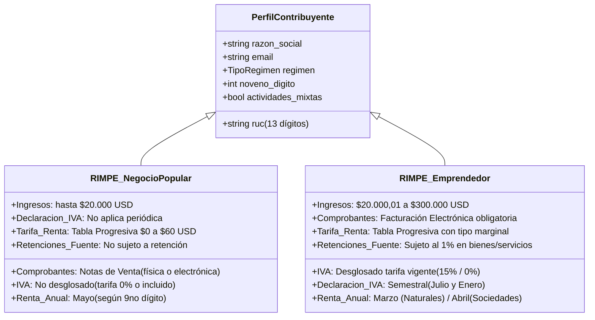
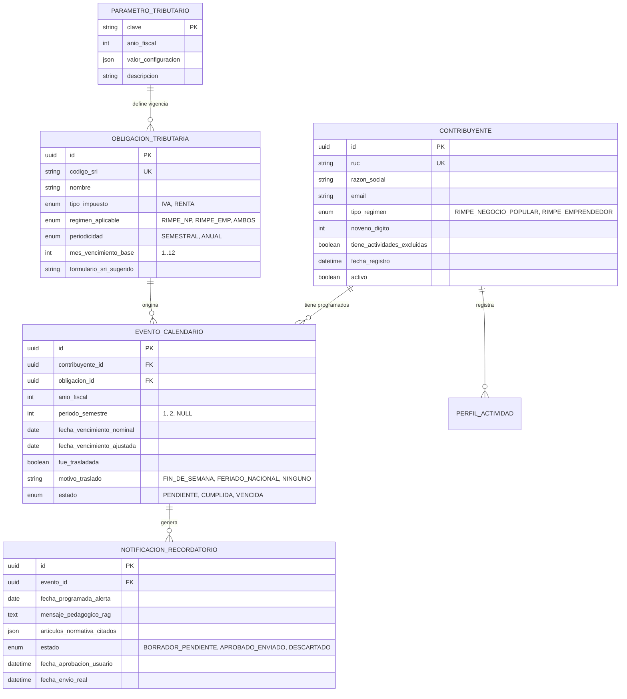

# Especificación de Requisitos y Modelo de Datos

| Metadato | Detalle |
| :--- | :--- |
| **Documento** | Especificación Formal de Requisitos del Software y Modelo de Datos |
| **Proyecto** | Calendario Tributario Inteligente para Emprendedores RIMPE (Caso 11) |
| **Fase / Semana** | Fase 1 – Semana 1 |
| **Estado** | Aprobado para Diseño de Arquitectura |
| **Fecha** | Octubre 2024 |
| **Versión** | 1.0.0 |

---

## 1. Perfiles de Usuario y Obligaciones Típicas del RIMPE

Con base en la normativa oficial del SRI (*LRTI*, *RALRTI*, *Resolución NAC-DGERCGC24-00000027*, *Resolución NAC-DGERCGC23-00000034* y *Ley de Eficiencia Económica*), se formalizan los siguientes perfiles de usuario y su matriz de obligaciones tributarias:



### 1.1. Perfil 1: RIMPE - Negocio Popular
* **Criterio de Inclusión:** Persona natural con ingresos brutos anuales de hasta \$20.000,00 USD en el ejercicio anterior.
* **Deberes Formales y Obligaciones Típicas:**
  1. Emitir y entregar **Notas de Venta** autorizadas con la leyenda impresa o digital *"Contribuyente Negocio Popular - Régimen RIMPE"*.
  2. Cobrar valor final sin desglosar IVA.
  3. Llevar un Registro simplificado de Ingresos y Gastos.
  4. Declarar y pagar el Impuesto a la Renta de forma anual en el mes de **mayo**, según el noveno dígito del RUC.
  5. Pagar la cuota fija progresiva de \$0,00 a \$60,00 USD según la escala de la Ley de Eficiencia Económica.
  6. Presentar declaración informativa aunque sus ingresos se ubiquen en el tramo de \$0 a \$2.500 USD (tarifa \$0,00).

### 1.2. Perfil 2: RIMPE - Emprendedor
* **Criterio de Inclusión:** Personas naturales o sociedades con ingresos brutos anuales de \$20.000,01 hasta \$300.000,00 USD.
* **Deberes Formales y Obligaciones Típicas:**
  1. Emitir obligatoriamente **Facturación Electrónica** con desglose de IVA (15% o tarifa vigente) y la leyenda *"Contribuyente Régimen RIMPE"*.
  2. Llevar contabilidad o registro de ingresos y gastos según corresponda a su naturaleza legal.
  3. Declarar y liquidar el Impuesto al Valor Agregado (**IVA**) de forma **semestral**:
     - Semestre 1 (enero - junio): Vence en **julio** según el 9.º dígito del RUC.
     - Semestre 2 (julio - diciembre): Vence en **enero** del año siguiente según el 9.º dígito del RUC.
     - Presentar declaración semestral en \$0,00 si no existieron ventas ni compras gravadas.
  4. Declarar y pagar el Impuesto a la Renta anual en **marzo** (Personas Naturales) o **abril** (Sociedades), aplicando la tabla con porcentaje marginal sobre ingresos brutos.
  5. Soportar retenciones en la fuente de Impuesto a la Renta a una tarifa preferencial del 1% sobre sus ventas.

### 1.3. Perfil 3: Régimen Mixto (RIMPE + Régimen General)
* **Condición:** Contribuyente que realiza actividades bajo RIMPE y paralelamente percibe ingresos por actividades excluidas (servicios profesionales de tercer nivel, rentas de capital/arriendos, etc.).
* **Comportamiento:** Requiere coexistencia de comprobantes (facturas con desglose para servicios profesionales y notas de venta/facturas para actividad RIMPE) y declaraciones independientes o consolidadas según directrices del SRI.

---

## 2. Historias de Usuario con Criterios de Aceptación (Gherkin)

Se especifican **10 Historias de Usuario completas**, cubriendo la totalidad del flujo funcional:

---

### HU-01: Registro de Perfil y Validación Algorítmica de RUC
* **Como** emprendedor contribuyente ecuatoriano,
* **Quiero** registrar mis datos fiscales (RUC, régimen RIMPE, correo electrónico y tipo de actividad),
* **Para** que el sistema configure mi perfil tributario personalizado y determine automáticamente mi noveno dígito.

#### Criterios de Aceptación:
```gherkin
Escenario: Registro exitoso con RUC válido de Persona Natural
  Dado que el usuario ingresa a la pantalla de registro
  Cuando ingresa un RUC válido de 13 dígitos de persona natural (ej. "0923456781001") que pasa el algoritmo Módulo 10 ecuatoriano
  Y selecciona el régimen "RIMPE Negocio Popular" y un correo válido "comercio@ejemplo.com"
  Entonces el sistema extrae el noveno dígito ("8")
  Y almacena el perfil en la base de datos
  Y redirige al usuario a la vista principal del Calendario Tributario.

Escenario: Rechazo de RUC con dígito verificador inválido
  Dado que el usuario intenta registrar un RUC
  Cuando ingresa un RUC con formato incorrecto o dígito verificador fallido (ej. "0923456789001")
  Entonces el backend rechaza la solicitud con código HTTP 422
  Y muestra un mensaje de error: "El RUC ingresado no cumple con el algoritmo oficial del SRI para personas naturales".
```

---

### HU-02: Generación Determinista de Fechas de Vencimiento
* **Como** contribuyente registrado,
* **Quiero** ver las fechas límites de mis declaraciones calculadas en base al noveno dígito de mi RUC,
* **Para** tener certeza matemática de cuándo vencen mis obligaciones según la Resolución NAC-DGERCGC23-00000034.

#### Criterios de Aceptación:
```gherkin
Escenario: Cálculo de vencimiento para RIMPE Emprendedor con noveno dígito 4
  Dado un usuario registrado como "RIMPE Emprendedor" con noveno dígito "4"
  Cuando el sistema genera las obligaciones del ejercicio fiscal
  Entonces la fecha base de vencimiento del IVA del 1er semestre (julio) se fija en el día 16 de julio
  Y la fecha base de vencimiento del IVA del 2do semestre (enero) se fija en el día 16 de enero
  Y la fecha base de vencimiento de Renta anual se fija en el día 16 de marzo.

Escenario: Negocio Popular no genera eventos periódicos de IVA
  Dado un usuario registrado como "RIMPE Negocio Popular"
  Cuando el sistema genera el calendario anual
  Entonces no incluye eventos semestrales ni mensuales de IVA
  Y programa únicamente la declaración y pago de Impuesto a la Renta para el mes de mayo en el día correspondiente a su noveno dígito.
```

---

### HU-03: Ajuste Automático por Fines de Semana y Feriados de Ecuador
* **Como** contribuyente,
* **Quiero** que el sistema traslade automáticamente mi fecha de vencimiento al primer día hábil siguiente si cae en fin de semana o feriado oficial,
* **Para** no adelantar pagos innecesariamente y cumplir con el artículo del Código Tributario ecuatoriano.

#### Criterios de Aceptación:
```gherkin
Escenario: Vencimiento coincide con día domingo
  Dado un usuario cuyo noveno dígito es "6" (vencimiento nominal: 20 de julio)
  Cuando el día 20 de julio corresponde a un día domingo
  Entonces el motor determinista traslada la fecha de vencimiento al lunes 21 de julio
  Y marca el evento con la bandera "fue_trasladada: true" y el motivo "Fin de semana (Código Tributario)".

Escenario: Vencimiento coincide con feriado nacional oficial
  Dado un usuario con vencimiento fijado para un día que consta en el catálogo oficial de feriados nacionales de Ecuador (ej. 10 de agosto o 2 de noviembre)
  Cuando el sistema computa el calendario
  Entonces traslada la fecha al siguiente día laborable oficial no festivo.
```

---

### HU-04: Explicación Didáctica de Obligaciones con RAG Normativo
* **Como** emprendedor no contador,
* **Quiero** hacer clic en cualquier obligación del calendario y recibir una explicación en lenguaje sencillo fundamentada en la normativa del SRI,
* **Para** entender qué comprobantes debo emitir, qué formulario llenar y qué pasos seguir sin confundirme con jerga técnica.

#### Criterios de Aceptación:
```gherkin
Escenario: Consulta de tarjeta de declaración de IVA semestral
  Dado que el usuario visualiza en su calendario el evento "Declaración Semestral de IVA"
  Cuando hace clic en el evento para ver su detalle
  Entonces el agente invoca el pipeline RAG consultando la base de datos vectorial
  Y recupera los fragmentos pertinentes de la Resolución NAC-DGERCGC24-00000027 y el RALRTI
  Y el LLM retorna un objeto estructurado en menos de 2 segundos que contiene:
    | Campo | Contenido requerido |
    | resumen_sencillo | Explicación ciudadana de 2 a 3 líneas |
    | formulario_sri | Código de formulario sugerido (ej. Formulario 104) |
    | comprobantes_validos | Tipo de facturación requerida |
    | base_legal_citada | Artículo y resolución oficial de sustento |
    | pasos_accionables | Lista ordenada de pasos prácticos (1, 2, 3) |.
```

---

### HU-05: Simulación Determinista de Cuota de Renta RIMPE
* **Como** contribuyente de Negocio Popular o Emprendedor,
* **Quiero** ingresar una estimación de mis ingresos brutos anuales en un simulador integrado,
* **Para** conocer con exactitud matemática el impuesto a pagar según las tablas oficiales de la Ley de Eficiencia Económica.

#### Criterios de Aceptación:
```gherkin
Escenario: Cálculo de cuota para Negocio Popular con ingresos de $12.000 USD
  Dado un usuario catalogado como Negocio Popular
  Cuando ingresa un valor proyectado de ingresos brutos de "$12.000,00"
  Entonces el sistema aplica el rango de $10.000,01 a $15.000,00 de la tabla del Art. 23 de la Ley de Eficiencia Económica
  Y retorna exactamente una cuota calculada de "$35,00 USD"
  Y aclara mediante texto RAG que no aplican deducciones de gastos personales en este régimen.

Escenario: Negocio Popular con ingresos menores a $2.500 USD
  Dado un usuario que ingresa ingresos brutos de "$1.800,00"
  Cuando presiona calcular
  Entonces el sistema retorna impuesto a pagar de "$0,00 USD"
  Y alerta que sigue obligado a presentar la declaración informativa anual en mayo.
```

---

### HU-06: Detección Programada de Obligaciones Próximas (Scheduler)
* **Como** sistema inteligente de automatización,
* **Quiero** ejecutar una tarea programada diaria en segundo plano (*Background Cron Job*),
* **Para** identificar todas las obligaciones que vencen en los próximos 7 días y 2 días y generar borradores de recordatorios personalizados.

#### Criterios de Aceptación:
```gherkin
Escenario: Ejecución de tarea programada de detección
  Dado que el reloj del sistema llega a la hora de corte diario (ej. 07:00 AM)
  Cuando el servicio de Scheduler (APScheduler / Celery) se ejecuta
  Entonces consulta los eventos del calendario con estado "PENDIENTE" cuya fecha de vencimiento calculada esté a 7 días o a 2 días de distancia
  Y para cada evento genera un borrador de correo con apoyo del agente RAG
  Y registra la notificación con estado "BORRADOR_PENDIENTE_APROBACION"
  Y NO despacha el correo electrónico hasta recibir confirmación humana.
```

---

### HU-07: Confirmación Explícita de Envío de Recordatorio (Human-in-the-Loop)
* **Como** usuario del sistema,
* **Quiero** visualizar en el panel de control del calendario los borradores de recordatorios generados y autorizar su envío con un botón de confirmación,
* **Para** tener control total sobre los correos que se despachan a mi bandeja y evitar spam.

#### Criterios de Aceptación:
```gherkin
Escenario: Aprobación y envío exitoso de correo recordatorio
  Dado que el usuario tiene un recordatorio generado en estado "BORRADOR_PENDIENTE_APROBACION"
  Cuando abre la notificación en el calendario, revisa el mensaje explicativo y presiona "Aprobar y Enviar Correo"
  Entonces el backend procesa el despacho a través del servicio de mensajería (SMTP / Resend / FastAPI-Mail)
  Y actualiza el estado de la notificación a "ENVIADO" con marca temporal
  Y el usuario recibe el correo con la explicación y el respaldo normativo.

Escenario: Cancelación o descarte del recordatorio
  Dado que el usuario prefiere no recibir el recordatorio por correo
  Cuando presiona "Descartar Recordatorio"
  Entonces el sistema actualiza el estado a "DESCARTADO" y no realiza llamadas al servidor de correo.
```

---

### HU-08: Gestión de Actividades Excluidas (Régimen Mixto)
* **Como** contribuyente que realiza actividades mixtas (ej. tienda de abarrotes y servicios profesionales),
* **Quiero** indicar en mi perfil que realizo actividades excluidas del RIMPE,
* **Para** que el calendario me muestre de forma diferenciada las obligaciones del RIMPE y las del Régimen General.

#### Criterios de Aceptación:
```gherkin
Escenario: Perfil mixto con actividad profesional
  Dado que el usuario activa la casilla "Realizo actividades de servicios profesionales o comisiones"
  Cuando se actualiza el calendario
  Entonces el calendario presenta etiquetas visuales diferenciadas:
    - Etiqueta Azul: "RIMPE - Tienda de abarrotes"
    - Etiqueta Naranja: "Régimen General - Servicios Profesionales"
  Y el motor RAG incluye en las explicaciones la advertencia del Art. 4 de la Res. NAC-DGERCGC24-00000027 sobre la no aplicabilidad de notas de venta a los servicios profesionales.
```

---

### HU-09: Alerta Pedagógica para Declaración en Cero
* **Como** contribuyente de RIMPE Emprendedor sin actividad en un semestre,
* **Quiero** que el recordatorio me advierta sobre la obligatoriedad de declarar en cero,
* **Para** no incurrir en multas de \$30,00 USD por creer erróneamente que no debo presentar nada.

#### Criterios de Aceptación:
```gherkin
Escenario: Notificación de advertencia de declaración en cero
  Dado un evento de vencimiento semestral de IVA para RIMPE Emprendedor
  Cuando el RAG redacta el recordatorio explicativo
  Entonces incluye un apartado destacado: "Atención: Si no tuviste ventas ni compras en este semestre, debes presentar obligatoriamente la declaración informativa con valores en cero para evitar multas del SRI".
```

---

### HU-10: Sincronización o Descarga del Calendario Personalizado
* **Como** contribuyente usuario de Google Calendar o dispositivos móviles,
* **Quiero** exportar mis fechas de vencimiento en formato estándar `.ics` (iCalendar),
* **Para** tener las alertas integradas en mi teléfono personal.

#### Criterios de Aceptación:
```gherkin
Escenario: Descarga de archivo .ics personalizado
  Dado que el usuario tiene su calendario tributario anual generado
  Cuando presiona "Sincronizar con Google Calendar / Descargar .ics"
  Entonces el sistema descarga un archivo estándar `calendario_tributario_sri_[RUC].ics`
  Y los eventos contienen como descripción el resumen pedagógico generado y el enlace a la base legal.
```

---

## 3. Requisitos No Funcionales (RNF) Medibles

| ID | Categoría | Requisito No Funcional | Métrica / Criterio de Verificación |
| :---: | :--- | :--- | :--- |
| **RNF-01** | **Rendimiento** | Latencia de cálculo determinista | El cálculo matemático de vencimientos por noveno dígito y feriados debe resolverse en **< 50 milisegundos**. |
| **RNF-02** | **Rendimiento** | Latencia de generación RAG | El tiempo de recuperación vectorial y generación de la tarjeta didáctica con Gemini Flash no debe exceder de **2.5 segundos** en el 95% de las peticiones (P95). |
| **RNF-03** | **Fidelidad Legal** | Cero alucinaciones en fechas numéricas | Las fechas de vencimiento nunca son inferidas por el LLM. El 100% de las fechas se generan mediante algoritmo determinista en Python y se inyectan como variables inmutables al prompt. |
| **RNF-04** | **Seguridad** | Protección de identificadores fiscales | El RUC y correo del contribuyente deben tratarse con validación estricta de inyección SQL/NoSQL y transmitirse bajo canales seguros **HTTPS / TLS 1.3**. |
| **RNF-05** | **Disponibilidad** | Tarea en segundo plano resiliente | El Scheduler debe ser **idempotente**: si el proceso se reinicia, no debe duplicar la generación de recordatorios para un mismo evento y usuario. |
| **RNF-06** | **Usabilidad** | Interfaz centrada en Calendario | La página principal debe cargar la vista de cuadrícula mensual del calendario en **< 1 segundo**, sin popups invasivos ni ventanas de chat obligatorias. |
| **RNF-07** | **Mantenibilidad** | Desacoplamiento de parámetros cambiantes | Las tablas de tarifas, multas y reglas por noveno dígito deben estar parametrizadas en estructuras de datos externas o bases de datos, permitiendo su actualización anual sin recompilar la aplicación. |

---

## 4. Modelo de Datos del Sistema

El modelo relacional está diseñado para garantizar la integridad referencial y desacoplar la lógica de cálculo, la capa de RAG y las notificaciones:



### 4.1. Esquemas de Datos en Formato JSON / Pydantic

#### Esquema de Perfil de Contribuyente (`ContribuyenteSchema`):
```json
{
  "ruc": "0923456781001",
  "razon_social": "COMERCIAL Y PAPELERIA EL EMPRENDEDOR",
  "email": "contacto@emprendedor.ec",
  "tipo_regimen": "RIMPE_EMPRENDEDOR",
  "tiene_actividades_excluidas": false,
  "actividad_principal": "Venta al por menor de suministros de papelería",
  "noveno_digito": 8
}
```

#### Esquema de Evento de Calendario Calculado (`EventoCalendarioSchema`):
```json
{
  "id": "c1f7a2d4-89b1-4f8e-a812-78d10b71e112",
  "codigo_obligacion": "IVA-SEM-1",
  "nombre_obligacion": "Declaración Semestral de IVA - Primer Semestre",
  "anio_fiscal": 2024,
  "periodo": "SEMESTRE_1",
  "fecha_vencimiento_nominal": "2024-07-24",
  "fecha_vencimiento_ajustada": "2024-07-24",
  "fue_trasladada": false,
  "motivo_traslado": "NINGUNO",
  "estado": "PENDIENTE",
  "dias_restantes": 5
}
```

#### Esquema de Notificación RAG con Human-in-the-loop (`NotificacionSchema`):
```json
{
  "id": "notif-98213-abc",
  "evento_id": "c1f7a2d4-89b1-4f8e-a812-78d10b71e112",
  "destinatario_email": "contacto@emprendedor.ec",
  "fecha_programada_alerta": "2024-07-17",
  "borrador_mensaje": {
    "asunto": "Recordatorio SRI: Tu declaración de IVA vence el 24 de julio",
    "resumen_didactico": "Estimado contribuyente, como estás en RIMPE Emprendedor y tu noveno dígito es 8, debes presentar tu IVA del primer semestre (enero a junio) hasta el 24 de julio.",
    "formulario": "Formulario Múltiple de IVA (104 en línea)",
    "advertencia_en_cero": "Si no registraste ventas en este semestre, debes presentar la declaración informativa con valores en cero para evitar la multa de USD 30,00.",
    "base_legal": "Resolución NAC-DGERCGC23-00000034 Art. 3 y LRTI Art. 97.6"
  },
  "estado": "BORRADOR_PENDIENTE",
  "requiere_confirmacion": true
}
```
