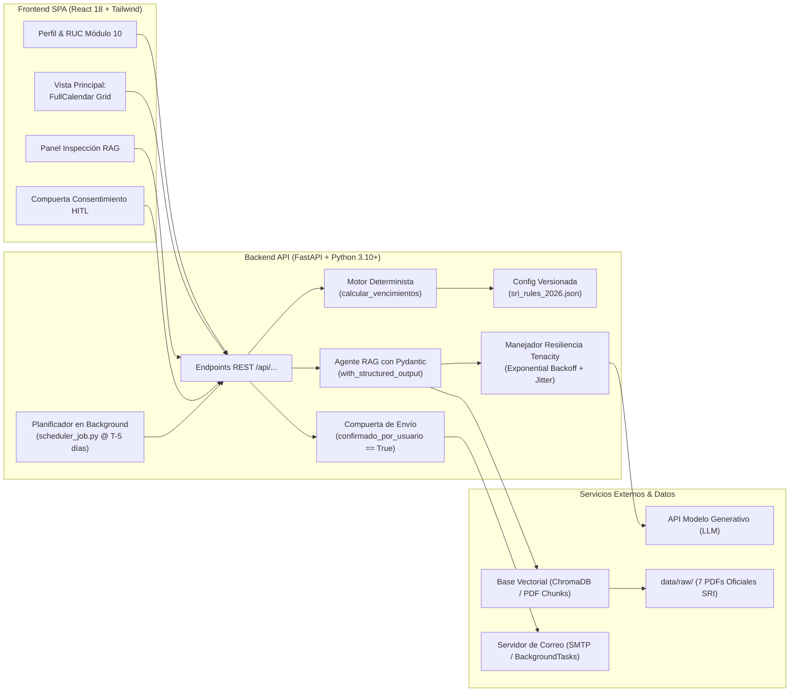
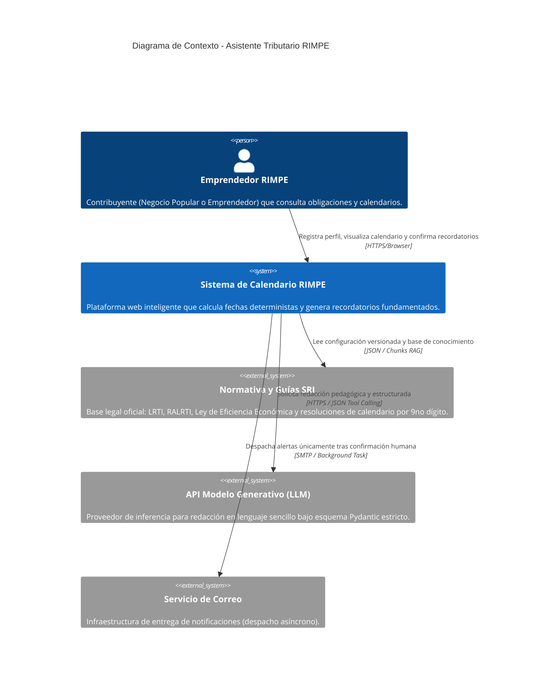
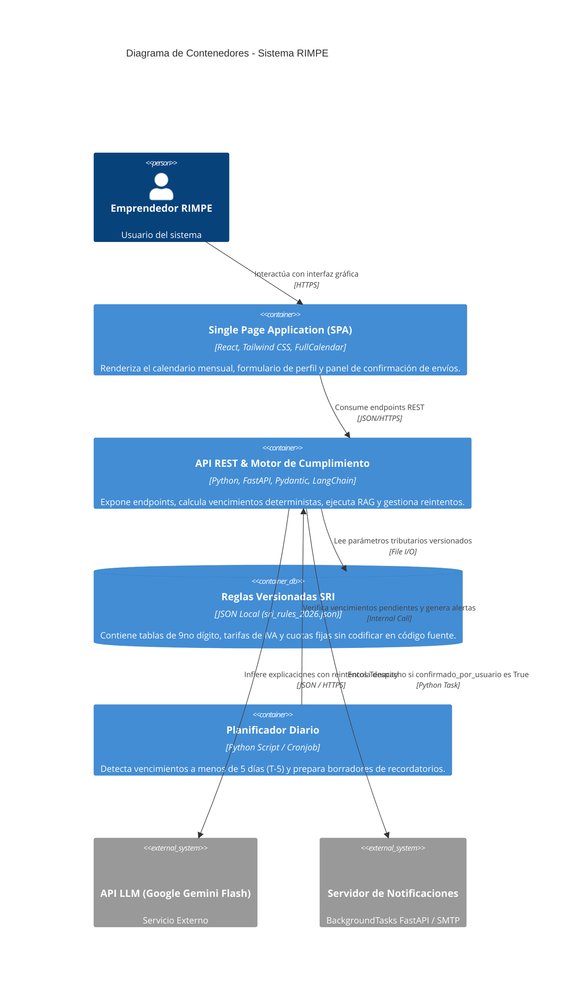
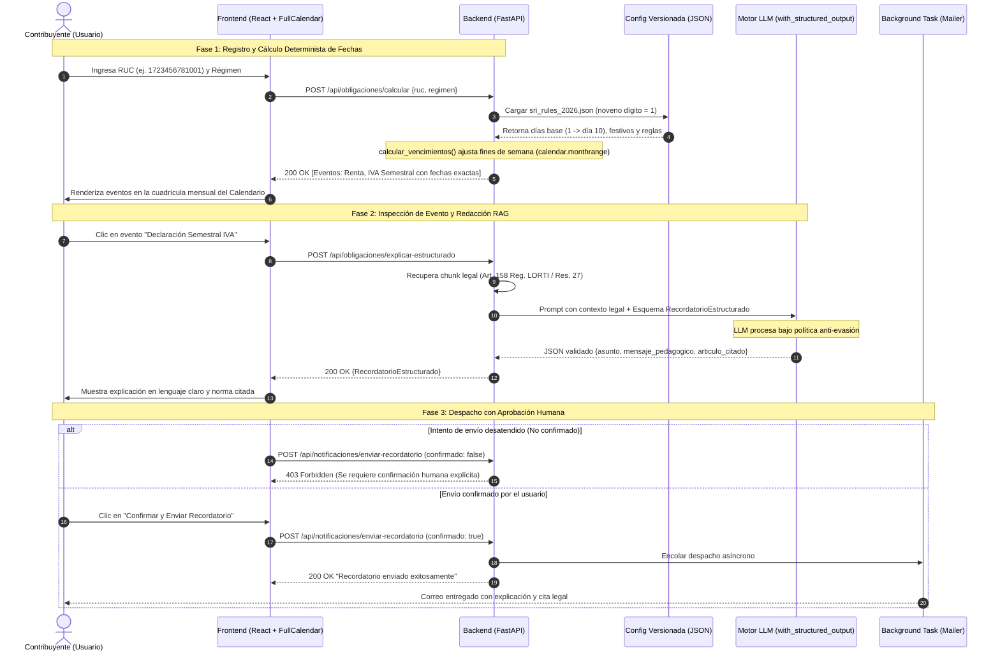

# Documento de Arquitectura de Software: Calendario Tributario Inteligente RIMPE

| Metadato | Detalle |
| :--- | :--- |
| **Documento** | Diseño y Especificación de Arquitectura de Software (C4 + Flujos) |
| **Proyecto** | Calendario Tributario Personalizado con Recordatorios para Emprendedores RIMPE (Caso 11) |
| **Fase / Semana** | Fase 1 – Semana 1 |
| **Enfoque Arquitectónico** | Arquitectura Híbrida (Motor Determinista + Agente RAG con Salida Estructurada + Compuerta HITL) |
| **Fecha** | Octubre 2024 |
| **Versión** | 1.0.0 |

---

## 1. Visión General de la Arquitectura y Componentes del Sistema

El sistema adopta una **arquitectura desacoplada y orientada a servicios**, donde se establece una frontera infranqueable entre el cálculo de plazos y obligaciones (lógica formal determinista) y la pedagogía tributaria (inteligencia artificial generativa con RAG).

---

### 1.1. Frontend (SPA React + Tailwind CSS + FullCalendar)
* **Pila Tecnológica:** React 18+, FullCalendar (`@fullcalendar/react`, `@fullcalendar/daygrid`, `@fullcalendar/interaction`), Tailwind CSS, Lucide React (iconografía).
* **Paradigma de Interfaz:** **Centrada en Calendario Mensual Interactivo.** Se descartan las interfaces conversacionales de tipo chatbot abierto como pantalla principal. El calendario es el tablero de control del contribuyente.
* **Módulos Principales de la UI:**
  1. **Perfil y Registro del Contribuyente:** Formulario de captura y validación sintáctica de RUC (13 dígitos numéricos mediante algoritmo Módulo 10 para personas naturales), selección de régimen (Negocio Popular o Emprendedor) y correo electrónico.
  2. **Visualizador de Calendario:** Renderiza las obligaciones fiscales calculadas de manera determinista como eventos temporales diferenciados cromáticamente (ej. azul para RIMPE, naranja para Régimen General).
  3. **Panel de Inspección RAG:** Drawer lateral o tarjeta modal que se activa al hacer clic en un evento del calendario, presentando la explicación en lenguaje sencillo y citando artículos normativos oficiales de sustento.
  4. **Control de Consentimiento (*Human-in-the-Loop*):** Botón y modal de confirmación explícita que previsualiza el borrador del recordatorio y habilita el despacho del correo electrónico tras autorización del contribuyente.

---

### 1.2. Backend (FastAPI + Pydantic v2 + LangChain + SQLite/JSON)
* **Pila Tecnológica:** Python 3.10+, FastAPI, Pydantic v2, LangChain (`langchain-core`, componentes de modelos LLM con soporte de llamada estructurada), Tenacity (reintentos exponenciales con jitter), Uvicorn.
* **Módulos Principales del Backend:**
  1. **Capa de Configuración Paramétrica (`config/sri_rules_2026.json`):** Almacén versionado y desacoplado del código fuente que contiene tarifas de IVA, cuotas progresivas fijas de Negocio Popular (\$0 a \$60 USD), tabla de vencimientos del noveno dígito y catálogo de feriados nacionales ecuatorianos.
  2. **Motor Determinista de Reglas (`calcular_vencimientos`, `calcular_iva`):** Funciones matemáticas puras que calculan fechas exactas y montos sin intervención de modelos probabilísticos, aplicando traslados automáticos por fines de semana (`calendar.monthrange`) y feriados oficiales.
  3. **Agente RAG con Salida Estructurada (`generar_recordatorio_validado`):** Enlaza el contexto legal del SRI (proveniente de los 7 PDFs oficiales en `data/raw/`) con un LLM restringido mediante esquema Pydantic (`with_structured_output`), garantizando que la salida contenga campos inmutables: `asunto`, `mensaje_pedagogico`, `formulario_sri`, `articulo_citado` y `advertencia_en_cero`.
  4. **Manejador de Resiliencia (`Tenacity`):** Estrategia de reintentos exponenciales con fluctuación aleatoria (*jitter*) para manejar límites de tasa (HTTP 429) y desconexiones temporales, con fallback determinista.
  5. **Compuerta de Envío (*Gatekeeper*):** Endpoint de notificación que aborta con **HTTP 403 Forbidden** si la petición carece de la bandera `confirmado_por_usuario == True`.
  6. **Flujo Asíncrono / Programado (`scheduler_job.py`):** Tarea en segundo plano (*Background Cron Job*) que escanea vencimientos a $T - 5$ días y genera borradores de notificación para su posterior aprobación por el usuario en la interfaz.

---

## 2. Modelo C4 de la Arquitectura

### 2.1. Nivel 1: Diagrama de Contexto del Sistema (*System Context*)
Muestra cómo interactúa el emprendedor y los sistemas externos con la plataforma inteligente:

---

### 2.2. Nivel 2: Diagrama de Contenedores (*Container Diagram*)
Detalla los límites de despliegue, tecnologías y flujos de datos entre frontend, backend, almacenamiento y APIs:

---

## 3. Diagrama de Secuencia del Flujo Completo

Este diagrama ilustra el ciclo integral: cálculo matemático determinista, consulta e inspección RAG estructurada y compuerta estricta de autorización humana (*Human-in-the-Loop*):

---

## 4. Separación Estricta de Responsabilidades (*Architectural Concerns*)

La arquitectura aplica el principio de **segregación estricta de responsabilidades** para garantizar confiabilidad técnica, cero alucinaciones y cumplimiento normativo ante el SRI:

| Dimensión | Capa Responsable | Mecanismo de Implementación | Justificación Técnica y de Calidad |
| :--- | :--- | :--- | :--- |
| **Cálculo de Fechas** | Motor Determinista (`main.py` / `services/calculator.py`) | Algoritmo determinista en Python + ajuste de fines de semana (`calendar.monthrange`) y catálogo de feriados ecuatorianos. | **Elimina el riesgo de alucinación temporal del LLM.** Un solo día de error en el vencimiento genera intereses por mora y multas al contribuyente. |
| **Tarifas y Coeficientes** | Configuración Versionada (`config/sri_rules_2026.json`) | Archivo JSON estructurado y desacoplado del código fuente. | **Garantiza el indicador de 0% de coeficientes "quemados" (*hardcoded*)** en el código. Facilita la actualización anual de tarifas sin recompilar el backend. |
| **Explicación Pedagógica** | Módulo Generativo RAG (`LangChain + LLM`) | Inyección de fragmentos legales vigentes de los PDFs oficiales en el contexto del prompt. | **Traduce lenguaje técnico-tributario forense a términos comprensibles** para microempresarios y personas de negocios populares, citando siempre la fuente oficial. |
| **Control de Estructura de Salida** | Esquema Pydantic (`RecordatorioEstructurado`) | `llm.with_structured_output(RecordatorioEstructurado)` y validación en API. | **Evita que el modelo responda texto libre no parseable o incompleto**, asegurando que los campos requeridos existan siempre y con tipos de datos válidos. |
| **Resiliencia ante Límites (HTTP 429)** | Capa de Conectividad (`Tenacity`) | Decorador `@retry` con retroceso exponencial (*exponential backoff* con jitter) y fallback determinista. | **Asegura que picos de demanda o límites de cuota de API no provoquen errores 500** en la aplicación web ni interrumpan las tareas batch del planificador. |
| **Responsabilidad y Autorización** | Capa de Notificaciones (Compuerta HITL) | Validación booleana estricta en endpoint HTTP (`confirmado_por_usuario == True`). | **Garantiza la supervisión humana (*Human-in-the-Loop*)**, previene despachos no solicitados (anti-spam) y asegura la responsabilidad jurídica y el consentimiento del contribuyente. |

---

## 5. Diseño del Flujo Programado (*Scheduler Job*)

El planificador opera como un servicio autónomo en segundo plano:

1. **Cadencia:** Se ejecuta diariamente a las 07:00 AM (hora continental de Ecuador).
2. **Ventana de Anticipación:** Filtra obligaciones con vencimiento a **$T - 5$ días** (5 días de anticipación).
3. **Generación de Borradores:**
   - Para cada obligación identificada, invoca al motor RAG para preparar el asunto y cuerpo explicativo adaptado al perfil del usuario.
   - Almacena el borrador con estado `BORRADOR_PENDIENTE_APROBACION`.
4. **Idempotencia:** Si el job se ejecuta múltiples veces en el mismo día por reinicio del contenedor, verifica la clave compuesta `(contribuyente_id, obligacion_id, anio_fiscal, periodo)` para no duplicar borradores ni enviar notificaciones repetidas.
5. **Compuerta de Envío:** Ningún correo se remite por SMTP hasta que el contribuyente ingrese a la interfaz web y accione el botón de autorización (`confirmado_por_usuario = true`).
