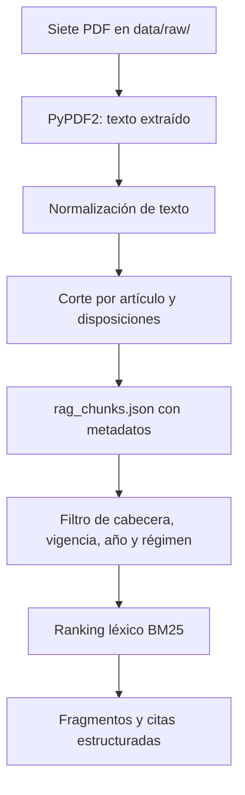

# Inventario de Fuentes Normativas y Estrategia de Fragmentación (RAG)

| Metadato | Detalle |
| :--- | :--- |
| **Documento** | Catálogo Oficial de Fuentes e Ingesta de Conocimiento |
| **Proyecto** | Calendario Tributario Inteligente para Emprendedores RIMPE (Caso 11) |
| **Fase / Semana** | Fase 1 – Semana 1 |
| **Ubicación de Fuentes Crudas** | `data/raw/` (rutas relativas al repositorio) |
| **Integridad Documental** | Siete PDF locales; la extracción textual y su vigencia requieren revisión |
| **Fecha de Actualización** | Octubre 2026 |
| **Versión** | 3.0.0 (Cuerpos normativos íntegros en PDF original) |

---

## 1. Inventario Formal de Fuentes Oficiales Íntegras

La base de conocimiento se construye a partir de siete PDF normativos locales atribuidos al Servicio de Rentas Internas (**SRI**), la Presidencia de la República y la Asamblea Nacional del Ecuador. La procedencia, integridad y vigencia deben verificarse frente a sus publicaciones oficiales antes de usar una cita para asesoría tributaria.

Los documentos fuente se encuentran en la carpeta relativa `data/raw/`. Su presencia facilita reproducir la ingesta, pero no constituye por sí sola prueba de integridad jurídica:

| ID | Documento Oficial | Emisor Oficial | Enlace Web de Origen Oficial | Vigencia | Archivo Local Relativo | Extensión y Páginas | Tamaño |
| :---: | :--- | :--- | :--- | :---: | :--- | :---: | :---: |
| **F01** | **Resolución N.º NAC-DGERCGC24-00000027** *(Normas de aplicación del RIMPE, categorización, actividades excluidas y deberes formales)* | Servicio de Rentas Internas (SRI) | [SRI Alfresco - Res. 27](https://www.sri.gob.ec/o/sri-portlet-biblioteca-alfresco-internet/descargar?id=7c3fb8dc-31a6-4fe3-a6c0-abe1def2c78a&nombre=NAC-DGERCGC24-00000027.pdf) | Vigente (31 de julio 2024 - Presente) | `data/raw/01_resolucion_sri_nac_dgercgc24_00000027.pdf` | PDF Oficial (9 págs.) | ~300 KB |
| **F02** | **Resolución N.º NAC-DGERCGC23-00000034** *(Calendario tributario, noveno dígito de RUC, plazos para IVA semestral e Impuesto a la Renta)* | Servicio de Rentas Internas (SRI) | [SRI Alfresco - Res. 34](https://www.sri.gob.ec/o/sri-portlet-biblioteca-alfresco-internet/descargar/680d53fa-89af-4dbf-9715-b82d7555279e/NAC-DGERCGC23-00000034.pdf) | Vigente (13 de diciembre 2023 - Presente) | `data/raw/02_resolucion_sri_nac_dgercgc23_00000034_calendario.pdf` | PDF Oficial (6 págs.) | ~360 KB |
| **F03** | **Ley Orgánica de Eficiencia Económica y Generación de Empleo** *(Reformas sustanciales al RIMPE, tabla progresiva cuotas Negocio Popular \$0-\$60, remisión)* | Asamblea Nacional / Registro Oficial Suplemento 461 | [Registro Oficial del Ecuador](https://www.registroficial.gob.ec) | Vigente (20 de diciembre 2023 - Presente) | `data/raw/03_ley_organica_eficiencia_economica_registro_oficial_461.pdf` | PDF Oficial (80 págs.) | ~390 KB |
| **F04** | **Reglamento para la Aplicación de la Ley de Régimen Tributario Interno (RALRTI)** *(Desglose reglamentario de deberes formales, RIMPE, facturación y retenciones)* | Presidencia de la República / SRI | [SRI Alfresco - RALRTI](https://www.sri.gob.ec/o/sri-portlet-biblioteca-alfresco-internet/descargar/fe699a5c-a49a-42e1-a71f-61d66e752ed8/Reglamento%20para%20la%20aplicacion%20de%20la%20Ley%20de%20Regimen%20Tributario%20Interno.pdf) | Codificación Vigente | `data/raw/04_reglamento_aplicacion_lrti.pdf` | PDF Oficial | 1.48 MB |
| **F05** | **Ley de Régimen Tributario Interno (LRTI - Codificación Oficial)** *(Capítulo del RIMPE Arts. 97.1 al 97.17 y régimen sancionador general)* | Asamblea Nacional / SRI | [SRI Alfresco - LRTI](https://www.sri.gob.ec/o/sri-portlet-biblioteca-alfresco-internet/descargar/68811e77-7b9c-4061-a2b4-c6a99696b00e/LEY_DE_REGIMEN_TRIBUTARIO_INTERNO_LRTI.pdf) | Codificación Vigente | `data/raw/05_ley_regimen_tributario_interno_lrti.pdf` | PDF Oficial (158 págs.) | 1.32 MB |
| **F06** | **Código Tributario de la República del Ecuador** *(Reglas generales de cómputo de plazos, prórrogas por fines de semana/feriados e infracciones)* | Congreso Nacional / SRI | [SRI Alfresco - Cód. Tributario](https://www.sri.gob.ec/o/sri-portlet-biblioteca-alfresco-internet/descargar/ecfc5e70-e0cf-4f52-b2ba-8c4fc8035f68/Codigo_Tributario_20_junio_2023.pdf) | Codificación Vigente | `data/raw/06_codigo_tributario_ecuador.pdf` | PDF Oficial (99 págs.) | 758 KB |
| **F07** | **Reglamento de Comprobantes de Venta, Retención y Documentos Complementarios** *(Régimen de notas de venta físicas/electrónicas, facturas y sustentación de costos)* | Presidencia de la República / SRI | [SRI Alfresco - Comprobantes](https://www.sri.gob.ec/o/sri-portlet-biblioteca-alfresco-internet/descargar/f3650927-c9e2-4985-a138-2b9ca3194c06/REGLAMENTO+DE+COMPROBANTES+DE+VENTA+RETENCI%D3N+Y+DOCUMENTOS+COMPLEMENTARIOS.pdf) | Codificación Vigente | `data/raw/07_reglamento_comprobantes_venta_retencion.pdf` | PDF Oficial | ~196 KB |

---

## 2. Estrategia de Fragmentación e Ingesta RAG (*Chunking Strategy*)

La implementación actual extrae texto con PyPDF2, normaliza saltos y divide por cabeceras de artículos. En las resoluciones separa los considerandos y las disposiciones para evitar que una mención de otra norma parezca un artículo propio. La extracción de PDF puede perder tablas o mezclar encabezados; el resultado requiere auditoría.



### 2.1. Parámetros Técnicos de Fragmentación:
* **Segmentación:** cabeceras de artículos y disposiciones mediante expresiones regulares; los artículos extensos se subdividen por párrafos, con un prefijo que conserva el identificador.
* **Umbral:** 2.400 caracteres por artículo antes de subdividir; objetivo de bloques cercano a 1.800 caracteres. No hay un solapamiento fijo de 80 tokens.
* **Resoluciones:** el texto anterior a `RESUELVE:` no recibe una cita de artículo de la resolución; las disposiciones llevan su propia cabecera.
* **Tablas:** no existe un extractor especializado de tablas ni metadato `content_type: tax_table`. Fechas y tarifas se calculan en Python desde `config/`; no deben deducirse de una tabla extraída de forma incompleta por el RAG.

---

## 3. Esquema de Metadatos para Filtrado Híbrido

Cada fragmento de `data/processed/rag_chunks.json` contiene campos como los siguientes:

```json
{
  "chunk_id": "05_ley_regimen_tributario_interno_lrti.pdf_chunk_0258",
  "documento": "Ley de Régimen Tributario Interno (LRTI)",
  "articulo_seccion": "Art. 97.6",
  "cita_oficial": "[Ley de Régimen Tributario Interno (LRTI), Art. 97.6]",
  "regimen": "AMBOS",
  "vigente": true,
  "anio_fiscal": 2026,
  "cabecera_verificable": true
}
```

El índice también guarda `contenido`, `jerarquia`, `url` y `longitud_caracteres`. No guarda el número de página. Una cita estructurada indica de qué fragmento procede el extracto, pero no confirma que el artículo sea suficiente o pertinente para contestar la pregunta. La auditoría local y sus fallos se documentan en [la evaluación](07-evaluacion.md#9-auditoría-local-del-rag-posterior-a-la-revisión-de-fuentes).
