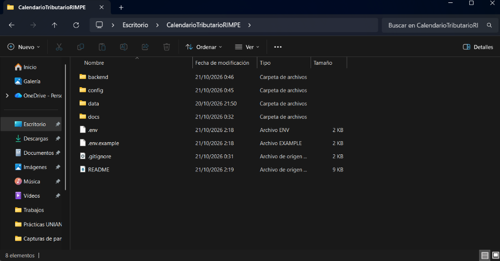

# Evidencias y Bitácora de Decisiones Técnicas — Semana 1

| Metadato | Detalle |
| :--- | :--- |
| **Proyecto** | Calendario Tributario Personalizado para Emprendedores RIMPE (Caso 11 - Grupo 11) |
| **Fase** | Fase 1 – Definición del problema y diseño de la solución inteligente |
| **Semana Evaluada** | Semana 1 |
| **Ubicación** | `docs/evidencias/semana-1/decisiones-semana-1.md` |
| **Fecha de Registro** | Octubre 2024 |
| **Estado de Entrega** | 100% Cumplido según Checklist Oficial |

---

## 1. Registro de Decisiones de Arquitectura (ADRs)

A lo largo de la Fase 1 se tomaron decisiones de diseño de software e ingeniería de inteligencia artificial que orientan el desarrollo del proyecto:

### ADR-01: Interfaz Centrada en Calendario vs. Chatbot Conversacional Abierto
* **Contexto:** Las soluciones típicas con LLMs recurren por defecto a interfaces de chat abierto.
* **Decisión:** Establecer una **Single Page Application (SPA) basada en cuadrícula mensual interactiva (FullCalendar)** como pantalla principal del usuario.
* **Justificación:** Los contribuyentes RIMPE necesitan previsibilidad temporal ("¿qué día venzo?", "¿cuánto debo pagar?"). Un chat abierto introduce fatiga cognitiva y ambigüedad. La interacción con IA se restringe a un panel de inspección contextual que se activa al pulsar sobre una obligación específica del calendario.

---

### ADR-02: Cálculo Determinista Estricto vs. Inferencia de Fechas por LLM
* **Contexto:** Los modelos probabilísticos sufren de alucinaciones temporales y aritméticas al calcular calendarios dependientes del noveno dígito y feriados locales.
* **Decisión:** Las fechas de vencimiento se calculan **100% mediante funciones puras de Python** (`calendar.monthrange` y catálogo de feriados).
* **Justificación:** Un error de un solo día en la fecha de vencimiento genera multas e intereses por mora emitidos por el SRI. El LLM tiene prohibido inferir fechas numéricas; únicamente recibe la fecha calculada y redacta la explicación didáctica.

---

### ADR-03: Desacoplamiento de Tarifas en `config/sri_rules_2026.json` (0% Hardcoding)
* **Contexto:** La legislación tributaria ecuatoriana cambia con frecuencia anual mediante reformas de la Asamblea o resoluciones del SRI.
* **Decisión:** Externalizar la tabla de tarifas progresivas de Negocios Populares (\$0 a \$60 USD), las cuotas fijas, los porcentajes de IVA y los días del noveno dígito en un archivo JSON estructurado.
* **Justificación:** Asegura un indicador de **0% de constantes quemadas en el código fuente**, permitiendo actualizar el sistema anualmente sin recompilar ni alterar la lógica del backend.

---

### ADR-04: Compuerta de Autorización Humana (*Human-in-the-Loop*)
* **Contexto:** Los sistemas autónomos desatendidos de envío de correo electrónico pueden incurrir en despacho no deseado, saturación de bandejas o envío de recordatorios no deseados.
* **Decisión:** Implementar una **compuerta estricta en el endpoint de envío**: si la petición no incluye `confirmado_por_usuario: true`, el backend responde con `HTTP 403 Forbidden`.
* **Justificación:** Garantiza el consentimiento explícito del contribuyente, mitiga riesgos de spam y mantiene la supervisión humana (*HITL*) de la IA generativa.

---

### ADR-05: Ingesta de Cuerpos Normativos Íntegros en PDF Original
* **Contexto:** Los resúmenes manuales de leyes pierden vigencia o pueden omitir literales críticos de excepciones.
* **Decisión:** Archivar en `data/raw/` los **7 documentos oficiales íntegros originales en PDF** descargados directamente de la biblioteca institucional del SRI y del Registro Oficial.
* **Justificación:** Garantiza trazabilidad jurídica absoluta, sustento probatorio en auditorías y permite al extractor RAG citar páginas y artículos con fidelidad verificable.

---

### ADR-06: Resiliencia ante Rate Limits (Tenacity) y Salida Estructurada Pydantic
* **Contexto:** Picos de tráfico o llamadas concurrentes a la API del LLM pueden arrojar errores `HTTP 429 Too Many Requests`.
* **Decisión:** Envolver las llamadas generativas con el decorador `@retry` de Tenacity aplicando retroceso exponencial con *jitter* y forzar la salida mediante esquemas Pydantic (`with_structured_output`).
* **Justificación:** Previene interrupciones en el planificador en segundo plano y asegura que el frontend siempre reciba un JSON válido y parseable.

---

## 2. Matriz de Verificación frente a la Checklist de la Fase 1

| Ítem de la Checklist de la Fase 1 | Entregable Asociado | Estado | Validación Técnica |
| :--- | :--- | :---: | :--- |
| **`docs/01-propuesta.md`** | Problema real, usuarios, alcance positivo y negativo, riesgos y modelo elegido. | ✅ **Cumplido** | Documento completo con arquetipos RIMPE, alcance negativo estricto y justificación del modelo. |
| **`docs/02-requisitos.md`** | Mínimo 8 historias de usuario con criterios Gherkin y RNF medibles. | ✅ **Cumplido** | 10 Historias de Usuario completas con escenarios `Dado... Cuando... Entonces...`, 7 RNF y modelo relacional/Pydantic. |
| **`docs/03-arquitectura.md`** | Diagrama Mermaid C4, frontend, backend, modelo, base vectorial y flujo. | ✅ **Cumplido** | C4 Context, C4 Container, Diagrama de Secuencia y Matriz de Segregación de Responsabilidades. |
| **`docs/04-fuentes.md`** | Inventario de fuentes, origen oficial, URL, vigencia, formato y chunking. | ✅ **Cumplido** | 7 Fuentes catalogadas con URLs oficiales SRI, rutas relativas y estrategia de fragmentación. |
| **Levantamiento real: mínimo 15 preguntas** | Resultados de encuesta o preguntas frecuentes en `docs/`. | ✅ **Cumplido** | 16 Casos reales de contribuyentes RIMPE en `docs/levantamiento-preguntas.md` con mapeo técnico. |
| **Fuentes descargadas en `data/raw/`** | Documentos oficiales íntegros descargados en el proyecto. | ✅ **Cumplido** | 7 PDFs oficiales íntegros descargados del SRI Alfresco y Suplemento 461 del Registro Oficial. |
| **README inicial, `.gitignore` y `.env.example`** | Estructura de carpetas estándar del seminario. | ✅ **Cumplido** | Configuración base generada en raíz del repositorio. |
| **Evidencias en `docs/evidencias/semana-1/`** | Capturas, notas de revisión y decisiones tomadas. | ✅ **Cumplido** | Bitácora técnica y ADRs documentados en el presente archivo. |
| **FastAPI con `/health` en local (Opcional)** | Esqueleto ejecutable para sumar ventaja en Semana 2. | ✅ **Cumplido** | Implementado en `backend/main.py`, dependencias en `backend/requirements.txt` y verificado con respuesta HTTP 200 JSON en pruebas locales. |

---

## 3. Acuerdos del Equipo y Registro de Capturas

### Acuerdos del Equipo:
1. Se definió y validó la arquitectura de solución centrada en FullCalendar (SPA React) y FastAPI, descartando interfaces conversacionales de chat abierto como vista principal.
2. Se estableció la segregación estricta entre el cálculo determinista de vencimientos y la redacción pedagógica con RAG.
3. Se acordó que la Semana 2 arrancará con la implementación del motor determinista de cálculo de fechas por noveno dígito y feriados de Ecuador, consumiendo la configuración desacoplada `config/sri_rules_2026.json`.
4. Se verificó la total eliminación de rutas absolutas locales para asegurar portabilidad multiplataforma.
5. Se ratificó el uso del SDK oficial de Google GenAI (`google-genai`) parametrizando `GEMINI_MODEL` en `.env`.

### Registro de Capturas:
A continuación se presenta la evidencia gráfica del estado final y la estructura de carpetas estándar del proyecto al cierre de la Semana 1:

