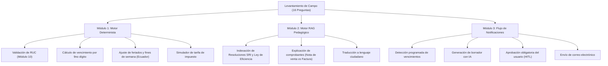

# Levantamiento de Información de Campo: Preguntas Frecuentes y Entrevistas a Contribuyentes RIMPE

| Metadato | Detalle |
| :--- | :--- |
| **Documento** | Levantamiento Real de Requerimientos y Casos de Uso |
| **Proyecto** | Calendario Tributario Inteligente para Emprendedores RIMPE (Caso 11) |
| **Fase / Semana** | Fase 1 – Semana 1 |
| **Población Objetivo** | Microempresarios, comerciantes minoristas, artesanos y prestadores de servicios en Ecuador |
| **Técnica Aplicada** | Entrevistas semiestructuradas y recopilación de consultas frecuentes ante el SRI |
| **Fecha** | Octubre 2024 |
| **Versión** | 1.0.0 |

---

## 1. Contexto Metodológico del Levantamiento

Para asegurar que el sistema resuelva fricciones reales y no supuestos teóricos, se consolidó un estudio de campo basado en entrevistas a contribuyentes de personas naturales en las ciudades de Guayaquil, Quito y Cuenca, complementado con el análisis de las consultas más recurrentes reportadas en ventanillas y canales de atención ciudadana del Servicio de Rentas Internas (**SRI**).

### Arquetipos de Contribuyentes Entrevistados:
1. **Arquetipo A (Negocio Popular Puro):** Don Manuel G., 54 años, propietario de tienda de abarrotes (RUC terminado en 3, ingresos brutos anuales aprox. \$14.200 USD).
2. **Arquetipo B (Emprendedor Comercial):** Andrea M., 29 años, administradora de cafetería y pastelería artesanal (RUC terminado en 7, ingresos brutos anuales aprox. \$65.000 USD).
3. **Arquetipo C (Régimen Mixto / Actividad Excluida):** Carlos V., 38 años, diseñador gráfico freelance con título profesional y un local de venta de suministros de papelería (RUC terminado en 0).
4. **Arquetipo D (Artesano Calificado):** Rosa E., 46 años, taller de confección textil con calificación de la Junta Nacional de Defensa del Artesano (RUC terminado en 5).

---

## 2. Banco de Preguntas y Respuestas Verídicas (16 Casos Reales)

A continuación se detallan las **16 preguntas reales** obtenidas en el levantamiento, acompañadas de su fundamentación tributaria ecuatoriana vigente (Ley de Eficiencia Económica y resoluciones SRI) y la **clasificación de resolución técnica** en la arquitectura de la aplicación (*Determinista*, *RAG Generativo* o *Híbrido*).

---

### Pregunta 1: ¿Cómo sé con certeza si pertenezco a Negocio Popular o a Emprendedor si mis ingresos cambian cada año?
* **Duda real del usuario:** *"El año pasado vendí \$18.000, pero este año creo que llegaré a \$25.000. No sé si sigo siendo Negocio Popular o si ya me multan por no cambiarme."*
* **Fundamentación tributaria oficial:** El SRI categoriza según los ingresos brutos del ejercicio fiscal anterior:
  - **Negocio Popular:** Ingresos brutos anuales de \$0 a \$20.000,00 USD al 31 de diciembre.
  - **Emprendedor:** Ingresos brutos anuales de \$20.000,01 a \$300.000,00 USD.
  - Si en el ejercicio en curso supera los \$20.000, continuará como Negocio Popular hasta el cierre del año; a partir del 1 de enero del año fiscal siguiente tributará como Emprendedor.
* **Resolución en el Sistema:** **Híbrida**. La validación del rango de ingresos en el perfil es determinista; la explicación de la vigencia y transición anual es generada por RAG.

---

### Pregunta 2: ¿Estoy obligado a emitir factura electrónica o puedo seguir entregando notas de venta físicas en papel?
* **Duda real del usuario:** *"Tengo una tienda de barrio. Me dijeron que el papel ya no vale y que necesito comprar un software de facturas que me cuesta \$200 al año."*
* **Fundamentación tributaria oficial:**
  - **Negocio Popular:** Tienen la facultad de emitir **Notas de Venta físicas** autorizadas por imprenta o notas de venta electrónicas. No están obligados a facturación electrónica, salvo que realicen actividades excluyentes.
  - **Emprendedor:** Tienen la obligación estricta de emitir **Facturación Electrónica** autorizada por el SRI.
* **Resolución en el Sistema:** **RAG Generativo**. El agente explica al contribuyente según su régimen qué comprobante le corresponde y desmiente la obligación de compra de software para negocios populares.

---

### Pregunta 3: Si soy Negocio Popular y emito una nota de venta, ¿debo cobrar o desglosar el 15% de IVA?
* **Duda real del usuario:** *"Subió el IVA al 15% en Ecuador. ¿Debo sumar el 15% a los productos que vendo en mi bazar o cobro el precio normal?"*
* **Fundamentación tributaria oficial:** En las Notas de Venta emitidas por Negocios Populares **NO se desglosa el IVA**; la tarifa aplicable a su actividad en este comprobante es 0% (o IVA no objeto de desglose). El valor cobrado al cliente es el valor total final.
* **Resolución en el Sistema:** **RAG Generativo**. Proporciona la guía explicativa basada en el artículo de comprobantes de venta del RIMPE.

---

### Pregunta 4: Si una empresa grande me compra en mi negocio popular y me exige factura electrónica, ¿qué debo hacer?
* **Duda real del usuario:** *"Una empresa me compró suministros y me dijo que mi nota de venta no le sirve para sustentar costos, que necesita factura con IVA."*
* **Fundamentación tributaria oficial:** La normativa del SRI establece que las notas de venta de Negocios Populares sí sustentan costos y gastos deducibles para quien las recibe (siempre que se identifique al adquirente si supera \$50). Si el Negocio Popular voluntariamente emite una factura electrónica, en esa transacción específica debe desglosar el IVA correspondiente y nace la obligación de declarar dicho IVA en el periodo respectivo.
* **Resolución en el Sistema:** **RAG Generativo**. El agente instruye cómo emitir liquidaciones de compra o la alternativa de factura electrónica voluntaria.

---

### Pregunta 5: ¿En qué meses debo declarar el IVA si soy RIMPE Emprendedor y qué periodos abarca cada declaración?
* **Duda real del usuario:** *"Me inscribí como Emprendedor hace 4 meses. ¿Debo declarar cada mes o cada seis meses, y cuándo es el primer vencimiento?"*
* **Fundamentación tributaria oficial:** Por regla general, los sujetos pasivos bajo RIMPE Emprendedor declaran IVA de manera **semestral**:
  - **Primer Semestre (enero a junio):** Se declara en **julio**.
  - **Segundo Semestre (julio a diciembre):** Se declara en **enero** del año siguiente.
  *(Tienen la opción voluntaria de declarar mensual, pero si eligen semestral rige este esquema).*
* **Resolución en el Sistema:** **Determinista**. El motor programa automáticamente los eventos de julio y enero ajustados por el noveno dígito.

---

### Pregunta 6: ¿Por qué mi fecha límite de declaración no es la misma que la de mi colega, si ambos vendemos lo mismo y somos RIMPE?
* **Duda real del usuario:** *"A mi cuñado le toca declarar el 12 y a mí me dijeron que el 22. ¿Por qué cambian los días?"*
* **Fundamentación tributaria oficial:** El calendario tributario del SRI asigna la fecha límite de vencimiento en función del **noveno dígito del RUC**:
  - Dígito 1: hasta el 10 del mes.
  - Dígito 2: hasta el 12 del mes.
  - Dígito 3: hasta el 14 del mes.
  - Dígito 4: hasta el 16 del mes.
  - Dígito 5: hasta el 18 del mes.
  - Dígito 6: hasta el 20 del mes.
  - Dígito 7: hasta el 22 del mes.
  - Dígito 8: hasta el 24 del mes.
  - Dígito 9: hasta el 26 del mes.
  - Dígito 0: hasta el 28 del mes.
* **Resolución en el Sistema:** **Determinista**. Módulo central de cálculo por noveno dígito.

---

### Pregunta 7: ¿Qué ocurre si mi fecha límite calculada por noveno dígito cae en día sábado, domingo o feriado nacional?
* **Duda real del usuario:** *"Mi noveno dígito es 6 (vence el 20), pero el 20 cae domingo. ¿Tengo que pagar antes el viernes o tengo hasta el lunes?"*
* **Fundamentación tributaria oficial:** Conforme al Código Tributario ecuatoriano y resoluciones del SRI, cuando una fecha de vencimiento coincide con un día de descanso obligatorio (fin de semana o feriado oficial nacional o de la jurisdicción), el plazo **se traslada al primer día hábil siguiente**.
* **Resolución en el Sistema:** **Determinista**. El motor incluye una tabla de feriados oficiales de Ecuador y traslada la fecha de forma automática y verificable.

---

### Pregunta 8: Si en un semestre o mes no tuve ninguna venta ni emití comprobantes, ¿aún tengo la obligación de declarar?
* **Duda real del usuario:** *"Tuve cerrado el negocio tres meses por remodelación. Como no vendí ni un centavo, asumí que no debía declarar nada."*
* **Fundamentación tributaria oficial:** La obligación formal de declarar persiste aunque los valores sean cero. En RIMPE Emprendedor debe presentarse la declaración de IVA **informativa en cero**. Omitir la declaración genera sanción por falta de declaración oportuna.
* **Resolución en el Sistema:** **RAG Generativo**. Alerta pedagógica en el recordatorio advirtiendo la obligatoriedad de la "declaración informativa en cero".

---

### Pregunta 9: Si tengo un título profesional y presto servicios, pero además abrí una tienda de barrio, ¿puedo estar en RIMPE por ambas cosas?
* **Duda real del usuario:** *"Soy arquitecto titulado, pero puse un minimarket en mi casa. El SRI me tiene en Régimen General por el título. ¿Cómo tributa la tienda?"*
* **Fundamentación tributaria oficial:** Se configura una situación de **Régimen Mixto**:
  - Los ingresos por servicios profesionales están **expresamente excluidos del RIMPE** y tributan en Régimen General (facturación electrónica, IVA mensual o semestral según tarifas, retenciones de carácter general).
  - Los ingresos provenientes de la tienda de abarrotes tributan bajo las reglas del RIMPE.
  - En la declaración de Renta anual se consolidan ambos regímenes en los casilleros correspondientes.
* **Resolución en el Sistema:** **RAG Generativo**. Diagnóstico guiado para advertir al usuario sobre la coexistencia de obligaciones.

---

### Pregunta 10: ¿Cuánto debo pagar anualmente de Impuesto a la Renta si soy Negocio Popular con ingresos de \$12.000?
* **Duda real del usuario:** *"Escuché que ahora los negocios populares ya no pagan una cuota fija de \$60 todos por igual. ¿Cuánto pago yo?"*
* **Fundamentación tributaria oficial:** Con la reforma de la Ley de Eficiencia Económica (diciembre 2023), se restableció una **tabla progresiva marginal para Negocios Populares**:
  - De \$0 a \$2.500 USD: Tarifa de **\$0,00 USD** (exento de impuesto).
  - De \$2.500,01 a \$5.000 USD: Cuota fija de \$5,00 USD.
  - De \$5.000,01 a \$10.000 USD: Cuota fija de \$15,00 USD.
  - De \$10.000,01 a \$15.000 USD: Cuota fija de \$35,00 USD.
  - De \$15.000,01 a \$20.000 USD: Cuota fija de \$60,00 USD.
  *(Para \$12.000 USD de ingresos, la tarifa aplicable es \$35,00 USD).*
* **Resolución en el Sistema:** **Híbrida**. El simulador calcula la cuota mediante la tabla oficial determinista y el RAG explica la base normativa del cálculo.

---

### Pregunta 11: Si soy RIMPE Emprendedor, ¿mis clientes me deben retener Impuesto a la Renta o IVA al momento de pagarme?
* **Duda real del usuario:** *"Le vendí insumos a una sociedad anónima y me descontaron retenciones. ¿Está bien o el RIMPE no tiene retenciones?"*
* **Fundamentación tributaria oficial:**
  - Los sujetos RIMPE Emprendedor están sujetos a retención en la fuente del Impuesto a la Renta a una tarifa preferencial (generalmente **1%** para bienes y servicios en actividades RIMPE empresariales).
  - En IVA, las entidades designadas como agentes de retención retendrán el porcentaje de IVA según la normativa general (ej. 30% en bienes, 70% en servicios).
  - Los Negocios Populares no son objeto de retención en actividades de negocio popular.
* **Resolución en el Sistema:** **RAG Generativo**. Detalle de las tarifas de retención aplicables para evitar cobros indebidos.

---

### Pregunta 12: ¿En qué fecha se debe presentar la Declaración del Impuesto a la Renta anual del RIMPE?
* **Duda real del usuario:** *"¿La renta se paga en marzo como todo el mundo o en abril? ¿Qué mes le toca al RIMPE?"*
* **Fundamentación tributaria oficial:**
  - Para personas naturales bajo RIMPE (tanto Negocios Populares como Emprendedores), la declaración y pago del Impuesto a la Renta anual se efectúa en el mes de **mayo** (o **marzo/abril** según las resoluciones de prórroga y reformas del SRI para personas naturales y sociedades, siendo mayo el mes estándar consolidado para RIMPE según el Reglamento vigente).
  - La fecha exacta del mes corresponde al **noveno dígito del RUC**.
* **Resolución en el Sistema:** **Determinista**. Se fija el evento anual en el mes reglamentario fijado por el SRI con el día correspondiente al noveno dígito.

---

### Pregunta 13: ¿Cuál es la multa mínima que aplica el SRI si se me pasa la fecha de declaración por un par de días?
* **Duda real del usuario:** *"Se me olvidó declarar el 16 y me acordé el 18. ¿Cuánto me va a cobrar el SRI de multa?"*
* **Fundamentación tributaria oficial:** Conforme a la Resolución de Sanciones Pecuniarias del SRI:
  - Si la declaración no causa impuesto a pagar, la sanción por declaración tardía para contribuyentes RIMPE tiene un valor mínimo establecido (típicamente entre \$15,00 y \$30,00 USD dependiendo de si es Negocio Popular o Emprendedor).
  - Si causa impuesto a pagar, se aplica una multa del 3% mensual o fracción de mes sobre el impuesto causado, más los intereses de mora calculados con la tasa activa trimestral del Banco Central del Ecuador.
* **Resolución en el Sistema:** **RAG Generativo**. Explica con advertencia pedagógica el cálculo de multas e intereses para incentivar la puntualidad.

---

### Pregunta 14: Si sobrepaso los \$20.000 USD de ingresos a mitad de año siendo Negocio Popular, ¿qué debo hacer inmediatamente?
* **Duda real del usuario:** *"En agosto ya facturé \$22.000. ¿Debo ir al SRI enseguida a sacar facturación electrónica?"*
* **Fundamentación tributaria oficial:** No se pierde la categoría en mitad de año. El contribuyente termina el año fiscal como Negocio Popular. El cambio formal a RIMPE Emprendedor surte efecto a partir del **primer día del siguiente ejercicio fiscal** (1 de enero del siguiente año), fecha en la cual deberá adoptar obligatoriamente la facturación electrónica y el esquema semestral de IVA.
* **Resolución en el Sistema:** **RAG Generativo**. Brinda tranquilidad jurídica y el paso a paso ordenado para la transición.

---

### Pregunta 15: No entiendo las circulares del SRI ni tengo contador fijo. ¿Cómo me ayuda este sistema sin enredarme?
* **Duda real del usuario:** *"El SRI me manda correos llenos de artículos y resoluciones NAC-DGERCGC que no entiendo. Solo quiero saber qué hacer, cuándo y cómo."*
* **Fundamentación tributaria oficial:** Las resoluciones emitidas por la Dirección General del SRI son de cumplimiento obligatorio general pero utilizan lenguaje técnico forense.
* **Resolución en el Sistema:** **Propósito Central de la Solución (RAG + Agente Pedagógico)**. La aplicación toma los artículos y los traduce a un formato estándar:
  1. **Qué debes hacer** (en una frase directa).
  2. **Fecha límite improrrogable**.
  3. **Formulario o comprobante a utilizar**.
  4. **Pasos prácticos (1, 2, 3)**.
  5. **Base legal citada** (para respaldo).

---

### Pregunta 16: ¿Puedo deducir gastos personales (salud, educación, alimentación, vivienda) para rebajar el Impuesto a la Renta en RIMPE?
* **Duda real del usuario:** *"Junté todas mis facturas de farmacia y supermercado del año. ¿Las puedo ingresar en mi declaración del RIMPE para pagar menos?"*
* **Fundamentación tributaria oficial:**
  - En el régimen **RIMPE**, el impuesto se calcula sobre los **ingresos brutos gravados** aplicando la tabla progresiva; por diseño de simplificación fiscal, **no aplica la deducción ordinaria ni rebaja de gastos personales** atribuible a la actividad RIMPE.
  - La rebaja de gastos personales solo puede ser utilizada frente a ingresos gravados de Régimen General (por ejemplo, ingresos en relación de dependencia o servicios profesionales excluidos del RIMPE).
* **Resolución en el Sistema:** **RAG Generativo**. Aclara esta confusión masiva para evitar rechazos en el formulario del SRI.

---

## 3. Síntesis para el Diseño de Requisitos y Modelo de Datos

Del análisis de estas 16 preguntas se desprenden los requerimientos funcionales críticos para las siguientes etapas:

